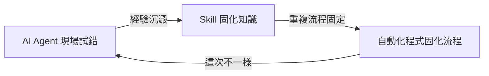

第五章 將 AI 模擬助理固化為自動化程式
---
### 什麼時候該固化成自動化

AI Agent 適合處理「這次不太一樣」的任務，但當同一件事情開始重複發生、輸入格式也越來越穩定，每次都讓 AI 重新推理一遍就是浪費 Token。判斷標準大致上有兩點：

- **輸入格式穩定**：例如固定欄位的 Excel 疊層表、固定命名規則的電容清單。
- **重複次數高**：同一套流程每週、每板都要跑一次。

只要同時滿足這兩點，就值得把【AI 現場寫出來的一次性程式碼】整理成【可重複執行的正式自動化腳本】，不必每次都重新讓 AI 推理一遍。固化完成後，這段程式無論執行多少次，都不再消耗任何 Token，只剩下本機或伺服器的運算時間成本，這也是為什麼重複次數高的流程值得花時間固化：固化一次的成本，可以換取之後無限次執行都免費的好處。

### 固化步驟

1. **參數化**：把 AI 當時硬編碼的檔名、數值，改成函式參數或命令列參數。
2. **加入錯誤處理**：針對正式任務可能發生的例外（檔案不存在、欄位少一欄）加上明確的錯誤訊息，而不是讓程式默默失敗。
3. **包裝成可重複執行的單位**：整理成函式或 CLI 工具，讓別人（或排程作業）可以直接執行，不需要透過對話式 AI。
4. **視需要包裝 GUI**：若使用者不熟悉命令列（例如其他非寫程式背景的同事），光有 CLI 仍然不夠方便，需要在外面再包一層簡單的 GUI（例如 Tkinter、PyQt 或網頁式介面），讓使用者選檔案、按下執行就能完成任務，不需要懂得在終端機下指令。這一步不是每套自動化都必需，只有當使用群面向非開發人員時才需要考慮。

### 版本控制與維護

固化後的自動化程式應納入 Git 管理，並經過人工 Code Review 確認邏輯正確。日後若輸入格式改變（例如 Excel 欄位調整、PyAEDT API 改版），需重新修改並測試，這部分維護工作仍可以請 AI Agent 協助讀差異、補測試。

#### 為何要用 Git 保存版本

AI Agent 現場寫的程式碼，往往是一邊試錯一邊改，若不納入版本控制，很容易發生「改對了一個片段，卻弄壞了另一個早已標定可用的片段」、或「忘記上次那個成功版本長什麼樣子」的情況。用 Git 保存版本能帶來幾個實際好處：

- **隨時可以回溯**：若 AI 這次修改把原本能執行的邏輯改壞，只要有進 Git，就可以直接 `git diff` 看出到底改了什麼，或用 `git checkout` / `git revert` 回到上一個可用版本，而不用靠記憶重寫。
- **每次提交都是一個可信日誌**：結合清楚的 commit message（例如「修正 stackup 匯入對地平面命名的判斷」），日後別人接手時可以從歷史紀錄看懂每次變更的原因，而不用只能猜測。
- **穩定版本可以打 Tag**：當自動化腳本進入正式使用階段，可以用 `git tag v1.0` 標記出經過驗證的穩定版本，日後若新版出問題，可以快速切回這個點。
- **多人協作不打架**：若同時有多人（或多個 AI Agent 任務）同時修改同一套自動化程式，Git 的 branch 與 merge 機制可以避免直接覆蓋彼此的修改。

實務上建議：每次讓 AI Agent 完成一段可用的自動化程式後，就立刻 `git commit` 一次，不要等到改了好幾輪才一次全提交；若專案中混雜了 AEDT 的 `.aedt`、`.aedb`、`.lock` 等二進制或自動生成檔，建議透過 `.gitignore` 排除，只讓 Git 追蹤真正需要審查的 Python 程式碼。

### 三層關係

- **AI Agent 現場試錯**：面對變化、不確定的情況，現場理解、現場寫一次性程式碼。
- **Skill 固化知識**：把重複出現的慣例與判斷，寫成可重複使用的指令模板，降低下次推理成本。
- **自動化程式固化流程**：當流程已穩定、重複次數高，改由不需 Token 的程式直接執行；若日後又出現新的例外，則回到最左邊交回 AI Agent 處理。
