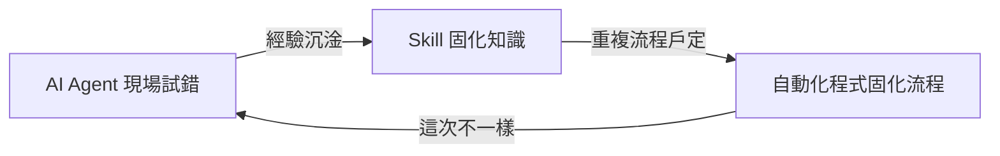

05. 轉換模擬助理為自動化程式
---
### 什麼時候該固化成自動化

AI Agent 適合處理「這次不太一樣」的任務，但當同一件事情開始重複發生、輸入格式也越來越穩定，每次都讓 AI 重新推理一遍就是浪費 Token。判斷標準大致上有兩點：

- **輸入格式穩定**：例如固定欄位的 Excel 疊層表、固定命名規則的電容清單。
- **重複次數高**：同一套流程每週、每板都要跑一次。

只要同時满足這兩點，就值得把【AI 現場寫出來的一次性程式碼】整理成【可重複執行的正式自動化腳本】，不必每次都重新讓 AI 推理一遵。

### 固化步驟

1. **參數化**：把 AI 當時硬編碼的檔名、數值，改成函式參數或命令列參數。
2. **加入錯誤處理**：針對正式任務可能發生的例外（檔案不存在、欄位少一欄）加上明確的錯誤訊息，而不是讓程式默默失敗。
3. **包裝成可重複執行的單位**：整理成函式或 CLI 工具，讓別人（或排程作業）可以直接執行，不需要透過對話式 AI。

### 版本控制與維護

固化後的自動化程式應納入 Git 管理，並經過人工 Code Review 確認邏輯正確。日後若輸入格式改變（例如 Excel 欄位調整、PyAEDT API 改版），需重新修改並測試，這部分維護工作仍可以請 AI Agent 協助讀差異、補測試。

### 三層關係

- **AI Agent 現場試錯**：面對變化、不確定的情況，現場理解、現場寫一次性程式碼。
- **Skill 固化知識**：把重複出現的慣例與判斷，寫成可重複使用的指令模板，降低下次推理成本。
- **自動化程式固化流程**：當流程已穩定、重複次數高，改由不需 Token 的程式直接執行；若日後又出現新的例外，则回到最左邊交回 AI Agent 處理。
