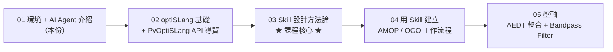
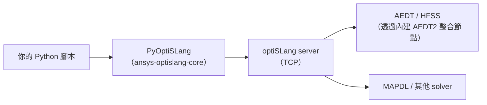

# 01 — 環境、PyAnsys 生態、AI Agent 介紹

> **本課目標**：讓你理解我們這門課在用什麼工具組合，並且把開發環境準備好。
> **預計閱讀時間**：25 分鐘
> **先備知識**：無。只需要能開啟 VS Code 與 Terminal。

---

## 1.1 課程地圖

這門課不是「PyOptiSLang 的 API 字典」，而是教你**怎麼用 AI 代理人替你寫 PyOptiSLang**。
核心理念只有一句話：

> 👉 **重點不在手寫，而是訓練 skill，讓 skill 替你做所有工作。**

5 份教材的關係如下：



- 第 1 份（本份）：打基礎，知道「我們手上有什麼牌」。
- 第 2 份：讓你第一次跟 optiSLang 說話（用 PyOptiSLang）。
- 第 3 份：**課程核心**。學完這份,你才真的學到「怎麼讓 AI 替你工作」。
- 第 4 份：拿第 3 份做出來的 skill，實作 AMOP / OCO 兩個經典工作流程。
- 第 5 份：壓軸，用一個真實的 Ansys HFSS 設計案（Bandpass_Filter.aedt）走完整個流程。

---

## 1.2 為什麼需要 Python 虛擬環境（`.venv`）

你電腦上的 Python 常常是**系統裝的**，被各種工具共用。如果你 `pip install` 什麼都裝進去，很快就會：

- 版本衝突（A 專案要 `numpy 1.x`，B 專案要 `numpy 2.x`）
- 權限錯誤（Windows 下動到系統 Python 會出事）
- 不可重現（換一台電腦就跑不起來）

**解法**：給每個專案建一個獨立的 `.venv/` 資料夾，裡面裝一份專屬的 Python 與套件。

```
d:\demo\1012c\                   ← 專案資料夾
├── .venv\                       ← 這個專案專用的 Python 環境
│   ├── Scripts\python.exe
│   └── Lib\site-packages\...    ← 這裡面裝 ansys-optislang-core
├── pyproject.toml               ← 專案描述檔
├── main.py                      ← 你的程式碼
└── uv.lock                      ← 鎖定版本，確保可重現
```

**好處**：
- 刪掉 `.venv/` 不會影響系統 Python。
- 其他人拿到 `pyproject.toml` + `uv.lock` 就能複製一模一樣的環境。
- 不同專案互不干擾。

---

## 1.3 用 `uv` 建立專案

[`uv`](https://docs.astral.sh/uv/) 是新一代的 Python 專案管理器（由 Astral 開發），比傳統 `pip + venv + poetry` 快 10 倍以上，而且指令非常簡單。

### 安裝 uv

Windows PowerShell：

```powershell
powershell -ExecutionPolicy ByPass -c "irm https://astral.sh/uv/install.ps1 | iex"
```

### 建立新專案

```bash
# 建立並進入專案資料夾
mkdir my_optislang_project
cd my_optislang_project

# 初始化 uv 專案（會自動產生 pyproject.toml、.venv、main.py）
uv init --python 3.12

# 加入 PyOptiSLang 套件
uv add ansys-optislang-core
```

執行完後，資料夾應該長這樣：

```
my_optislang_project\
├── .venv\                       ← uv 自動建立
├── .python-version
├── pyproject.toml               ← 已列出 ansys-optislang-core
├── uv.lock
├── main.py
└── README.md
```

### 執行 Python 腳本

**不要**自己啟動 `.venv`，用 `uv run`：

```bash
uv run python main.py
uv run python -c "import ansys.optislang.core; print(ansys.optislang.core.__version__)"
```

`uv run` 會自動用專案的 `.venv/` 執行，不需要手動 activate。

---

## 1.4 PyAnsys 生態系介紹

Ansys 的 Python API 統稱為 **PyAnsys**，是一整家族的套件。每個套件對應一個或多個 Ansys 產品：

| 套件 | PyPI 名稱 | 對應產品 | 本課用到 |
|---|---|---|---|
| **PyOptiSLang** | `ansys-optislang-core` | optiSLang（參數化設計、優化、Metamodel） | ✅ 主軸 |
| **PyAEDT** | `pyaedt` | Electronics Desktop（HFSS、Maxwell、Icepak…） | ⚠️ 間接用到 |
| PyMAPDL | `ansys-mapdl-core` | Mechanical APDL（結構分析） | ❌ |
| PyFluent | `ansys-fluent-core` | Fluent（流體） | ❌ |
| PyDPF | `ansys-dpf-core` | Data Processing Framework | ❌ |

**本課為什麼只用 PyOptiSLang？**

optiSLang 是**總指揮**：它會呼叫其他求解器（HFSS、MAPDL 等）跑一堆設計變異，然後幫你做統計分析與優化。
我們**不需要**直接呼叫 PyAEDT 操作 HFSS —— optiSLang 的 AEDT2 整合節點會替我們做這件事。



---

## 1.5 AI Agent 的三個層次

AI 助手不是只有一種形態。從簡單到強大分成三階：

### 層次 1：Chat（純對話）

```
使用者：「幫我寫一段 PyOptiSLang 開啟專案的程式碼」
AI：  「from ansys.optislang.core import Optislang ... osl = Optislang()」
使用者（複製貼上）→ 自己執行 → 看到錯誤 → 回來再問
```

**缺點**：AI 看不到你的環境、檔案、錯誤訊息，每一步都要你人工搬運。

### 層次 2：Agent（可操作工具）

```
使用者：「幫我在 d:\demo 建一個 PyOptiSLang 專案並跑起來」
AI：
  → 執行 shell: uv init
  → 執行 shell: uv add ansys-optislang-core
  → 寫檔案 main.py
  → 執行 shell: uv run python main.py
  → 讀取輸出，發現錯誤
  → 自動修正
```

**優點**：AI 可以直接動手。
**缺點**：對於**不熟的領域**（例如 PyOptiSLang），AI 的訓練資料可能是舊的或錯的，容易「幻覺」出不存在的 API。

### 層次 3：Skill-driven Agent（有專業知識的 Agent）

```
使用者：「建一個 2-input/1-output 的 AMOP」
AI 載入 pyoptislang skill：
  → 知道必須用 node_types.AMOP
  → 知道 Python 節點是 node_types.Python2 + DesignFlow.RECEIVE_SEND
  → 知道 register_location_as_parameter 之後要 modify_parameter 設 range
  → 知道一定要 try/finally + osl.dispose()
  → 一次就寫對程式碼
```

**關鍵差異**：**skill 是一份 markdown 檔**，裡面記錄了這個領域的規則、慣例、踩過的雷。載入 skill 後，Agent 就像換了一顆大腦。

> 📌 **本課的核心**就是教你**怎麼寫 skill**。這也是為什麼第 3 份教材最重要。

---

## 1.6 Synopsys Autopilot：VS Code 裡的 Agent

**Autopilot** 是 Synopsys 做的 AI 助手，以 VS Code 擴展形式運作。它有幾個特別的能力，是本課用來訓練 skill 的平台：

### 核心功能

| 功能 | 用途 |
|---|---|
| **Chat panel** | 跟 AI 對話 |
| **Shell / Terminal access** | AI 可以直接跑 `uv run` / `git` / 任何 shell 指令 |
| **File read/write/edit** | AI 可以讀寫你專案裡的檔案 |
| **Plan mode** | AI 先規劃、你確認後再執行（防止一下子跑太多亂步） |
| **Question tool** | AI 不會亂猜，有疑問就用結構化選單問你 |
| **Skill 系統** | 載入 `.synopsys_autopilot/skills/<name>/SKILL.md` 當作專業知識 |
| **Subagent** | 可以把特定任務外包給獨立的子代理人 |
| **`/create-skill`** | 一句指令開啟訓練 skill 的互動流程 |

### Skill 存放位置

Autopilot 的 skill 可以放在兩個地方：

```
# 專案層（跟著 Git repo 走，團隊共用）
d:\demo\1012c\.synopsys_autopilot\skills\<skill-name>\SKILL.md

# 全域層（跟著使用者走，所有專案都能用）
C:\Users\<你的帳號>\.synopsys_autopilot\skills\<skill-name>\SKILL.md
```

本課教材會把所有 skill 放在**專案層**（`d:\demo\1012c\.synopsys_autopilot\skills\`），這樣 Git clone 下來就能用。

---

## 1.7 第一次互動：確認環境正常

打開 Autopilot 的 chat panel（VS Code 側欄），輸入：

```
請用 uv run 幫我確認這個專案已經裝好 ansys-optislang-core，並印出版本號
```

Autopilot 預期的動作：

```
💬 Agent：好的，我會執行 uv run python -c "import ansys.optislang.core; print(ansys.optislang.core.__version__)"

🔧 shell:
   uv run python -c "import ansys.optislang.core; print(ansys.optislang.core.__version__)"

📤 輸出：
   1.7.0

✅ 專案已安裝 ansys-optislang-core 1.7.0，可以開始了。
```

如果看到版本號印出來，環境就 OK。

### 如果看到 import error

```
ModuleNotFoundError: No module named 'ansys'
```

表示 `.venv` 裡沒裝套件。請 Autopilot 執行：

```
uv add ansys-optislang-core
```

再試一次。

---

## 📝 小練習

請用 Autopilot chat 完成下列任務，不要自己手打程式碼。

1. **練習 1**：請 Autopilot 建立一個 `hello.py`，內容是列出 PyOptiSLang 的版本與目前的 Python 路徑。然後執行它。

   提示訊息：
   > 「幫我在這個專案建一個 hello.py，印出 pyoptislang 版本和 python 執行路徑，然後用 uv run 跑一次」

2. **練習 2**：請 Autopilot 列出 `.venv/Lib/site-packages/` 下所有 `ansys` 開頭的套件。

3. **練習 3**：問 Autopilot：「PyAEDT 跟 PyOptiSLang 有什麼差別？什麼時候該用哪個？」—— 觀察它的回答有沒有引用具體的套件版本或功能。

---

## 📌 本課重點整理

- 本課的目標是**訓練 skill**，不是手寫 PyOptiSLang。
- Python 專案要用 `.venv` 隔離，推薦用 `uv` 管理（指令簡單、速度快）。
- PyOptiSLang 是 PyAnsys 家族的一員，負責**參數化設計與優化**，會呼叫其他求解器。
- AI Agent 分三層：**Chat → Agent → Skill-driven Agent**。本課用的是最高層的 Skill-driven Agent。
- Synopsys Autopilot 是本課指定的 AI 平台，提供 skill 系統與完整的工具權限。
- Skill 是一份 markdown 檔，放在 `.synopsys_autopilot/skills/<name>/SKILL.md`。

---

## 🔗 相關資源

- [uv 官方文件](https://docs.astral.sh/uv/)
- [PyAnsys 總入口](https://docs.pyansys.com/)
- [PyOptiSLang 文件](https://optislang.docs.pyansys.com/)
- [Ansys optiSLang 產品頁](https://www.ansys.com/products/connect/ansys-optislang)
- 本專案的 skill 範例：`.synopsys_autopilot/skills/pyoptislang/SKILL.md`（第 3 份教材會深入解析）

---

## ❓ 自我檢核題

1. 為什麼不要把 `ansys-optislang-core` 直接 `pip install` 到系統 Python？
2. `uv run python main.py` 比 `python main.py` 多做了哪件事？
3. Chat、Agent、Skill-driven Agent 的差別是什麼？為什麼本課要用 Skill-driven Agent？
4. Skill 檔案的完整路徑是什麼？你能背出來嗎？
5. optiSLang 跟 HFSS 的關係是什麼？為什麼本課只用 PyOptiSLang，不直接用 PyAEDT？

---

## ➡️ 下一份教材預告

**02 — optiSLang 基礎 + PyOptiSLang API 快速導覽**

你會學到：
- optiSLang 到底是什麼（概念不懂的話，就算會寫 PyOptiSLang 也沒用）
- Parameter、Response、Criterion、Design 四個核心名詞
- `Optislang → Application → Project → RootSystem → Nodes` 階層
- 寫出你的第一個完整範例：**2 input / 1 output 的 AMOP metamodel 訓練**
