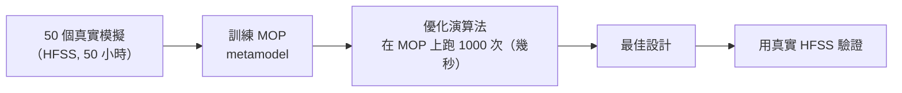
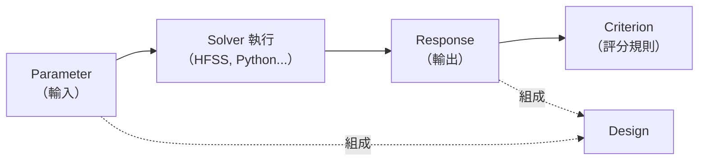
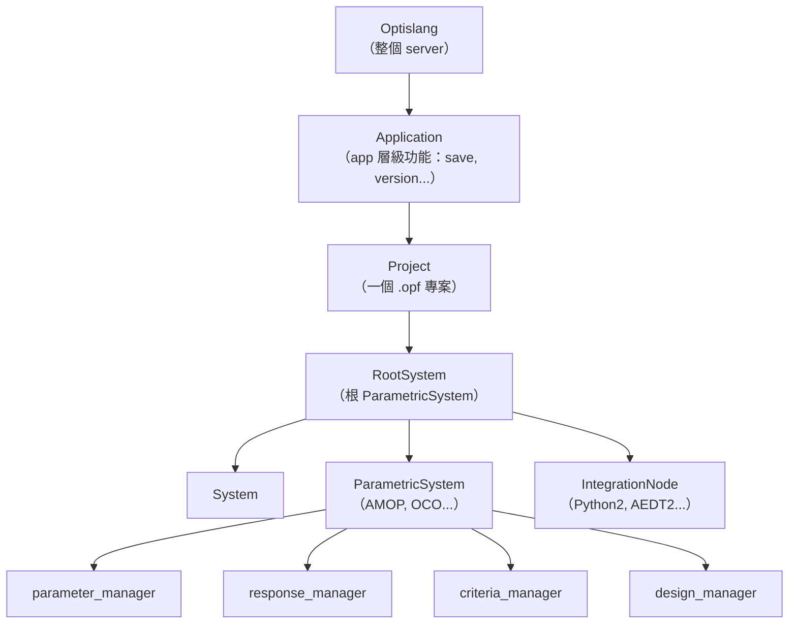
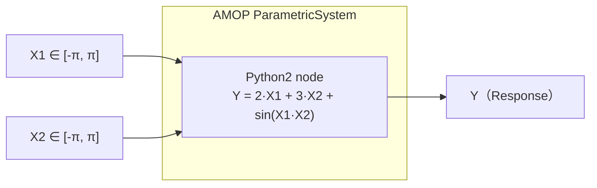

# 02 — optiSLang 基礎 + PyOptiSLang API 快速導覽

> **本課目標**：建立 optiSLang 的心智模型，並寫出你的第一個完整 PyOptiSLang 範例。
> **預計閱讀時間**：30 分鐘
> **先備知識**：第 1 份教材。環境已經可以 `uv run python` 匯入 `ansys.optislang.core`。

---

## 2.1 optiSLang 是什麼？

一句話：

> **optiSLang 是一個「參數化模擬工作流程編排器」。**

它不自己做 CAE 計算，而是**指揮**其他 solver（HFSS、MAPDL、Fluent…）跑數十到數千次設計變異，然後幫你做統計分析、建立代理模型（metamodel）、進行優化。

### 五種常見用途

| 用途 | 中文 | 做什麼 |
|---|---|---|
| **Sensitivity analysis** | 敏感度分析 | 「哪些參數對結果影響最大？」 |
| **Metamodel (MOP) training** | 代理模型訓練 | 用少量真實模擬訓練出一個「數學替身」，用它取代真實求解器 |
| **Optimization** | 優化 | 找到讓目標最佳化的參數組合 |
| **Robustness** | 穩健性分析 | 考慮製程公差，算最終結果的分布 |
| **Reliability** | 可靠度分析 | 計算失效機率 |

本課會聚焦在前三種：**Sensitivity + Metamodel + Optimization**。

### 為什麼需要 metamodel？

真實的 HFSS/MAPDL 模擬可能一次要跑 1 小時以上。如果優化演算法要試 1000 個設計，直接做要 1000 小時。

**解法**：先用 ~50 個真實模擬訓練一個 metamodel（例如 Kriging、Polynomial Regression、Neural Network），之後優化演算法在 metamodel 上面試，1000 次只要幾秒鐘。



---

## 2.2 四個核心名詞

這四個詞你一定要記起來，整個 optiSLang 都在繞著它們轉：

### Parameter（參數）

輸入變數。可以是幾何尺寸、材料常數、電路元件值。

分三種：
- **OptimizationParameter**（可調整的設計變數，有 range）
- **StochasticParameter**（有統計分佈的隨機變數，用於 Robustness）
- **MixedParameter**（同時具備以上兩者，用於 Robust Design Optimization）

### Response（回應）

輸出值。從 solver 跑完的結果裡擷取出來。
可以是純量（`mass = 1.23`）或信號（`S11(freq)` 整條曲線）。

### Criterion（準則）

對 response 的評估規則，分三種：

- **ObjectiveCriterion**（目標）：`minimize mass`、`maximize gain`
- **ConstraintCriterion**（限制）：`max_stress < 25000 MPa`
- **VariableCriterion**（中間變數）：給後面的運算用

### Design（設計）

一次評估的實例。一個 Design 包含「這次 parameter 用什麼值」+「這次 response 跑出什麼結果」。

**關係圖**：



---

## 2.3 PyOptiSLang 的核心階層

PyOptiSLang 是一個嚴格的樹狀結構，所有操作都從**根**（`Optislang`）開始，往下導覽。**絕對不要**嘗試直接 import 內部類別來實例化。



### 常用屬性/方法速查

```python
osl = Optislang(ini_timeout=60)              # 建立或連線到 server
application = osl.application                 # 應用層
project = application.project                 # 現在開著的專案
root_system = project.root_system             # 根系統
root_system.create_node(type_=...)            # 建立子節點
root_system.find_nodes_by_name("AMOP")        # 找已有的節點
root_system.parameter_manager.get_parameters()
root_system.evaluate_design(design)           # 單點評估
project.start()                               # 執行專案
application.save() / save_as(path)            # 儲存
osl.dispose()                                 # 關閉 server（必做！）
```

---

## 2.4 四種常用節點類型

optiSLang 的「工作流程」是由節點拼出來的。每個節點有自己的輸入/輸出 slot，彼此用線連起來。

### A. ParametricSystem（參數化系統）

這是**演算法容器**。你把 solver 節點放在它裡面，它就會根據自己的演算法規則，自動產生一堆 design 丟給 solver 跑。

| Node type | 中文名 | 做什麼 |
|---|---|---|
| `node_types.AMOP` | 自適應代理模型 | **本課主軸**。自動跑樣本 → 訓練 MOP → 自適應補點 |
| `node_types.OCO` | One Click Optimization | 一鍵優化，內部自動結合 sampling + MOP + optimization |
| `node_types.Sensitivity` | 敏感度 | 純跑 Latin Hypercube sampling，不做優化 |
| `node_types.NLPQLP` | SQP 優化 | 經典梯度式優化 |
| `node_types.Robustness` | 穩健性 | 用隨機 sampling 評估公差效應 |

### B. IntegrationNode（整合節點）

**真正跑 solver 的節點**。它會接收一個 design，執行 solver，然後把 response 送回去。

| Node type | 做什麼 | 本課用到 |
|---|---|---|
| `node_types.Python2` | 內嵌 Python code | ✅ 教材 02、04 |
| `node_types.ProxySolver` | 外部 callback（最彈性） | ⚠️ 進階 |
| `node_types.Process` | 呼叫外部 exe | ❌ |
| `node_types.AEDT2` | Ansys Electronics Desktop | ✅ 教材 05 |

### C. DesignFlow：告訴整合節點「我是收還是送」

```python
from ansys.optislang.core.nodes import DesignFlow

DesignFlow.RECEIVE       # 只接收 design（例如 Parameterize 輸入節點）
DesignFlow.SEND          # 只送 response 回去（例如 ETK 輸出節點）
DesignFlow.RECEIVE_SEND  # 兩者都要（Python2、AEDT2 這種 solver）
```

**最常用的是 `RECEIVE_SEND`**：solver 接收 parameter 值，執行計算，送回 response。

### D. MOP / Mopsolver

當 AMOP 訓練完 metamodel，你可以用 `Mopsolver` 節點當作「真實 solver 的替身」。這在教材 04 的 OCO-on-MOP 範例會提到。

---

## 2.5 PyOptiSLang 的必備生命週期

**每一支** PyOptiSLang 腳本都要遵守這個模板：

```python
from ansys.optislang.core import Optislang

# 1. 建立或連線
osl = Optislang(ini_timeout=60)

try:
    # 2. 透過 application / project 操作
    application = osl.application
    project = application.project
    root_system = project.root_system
    # ... 建節點、設參數、跑模擬 ...

finally:
    # 3. 一定要 dispose！不然 optiSLang server 會留在記憶體
    osl.dispose()
```

### 為什麼要 `try / finally`？

optiSLang server 是一個獨立的背景進程（headless）。如果你的腳本中途當掉但沒有 `dispose()`，那個 server 會一直占著記憶體與 License，你下次要重啟整台電腦才清得掉。

**90% 的 PyOptiSLang 新手都栽在這裡**。把這個模板背起來。

---

## 2.6 第一個完整範例：2-input / 1-output + AMOP

接下來你要寫一支腳本，做這些事：

1. 建立一個 AMOP 參數化系統
2. 裡面放一個 Python2 solver 節點
3. Python 節點收 2 個輸入 `X1, X2`，計算輸出 `Y = 2*X1 + 3*X2 + sin(X1*X2)`
4. 註冊 2 個 OptimizationParameter 與 1 個 Response
5. 執行 AMOP 訓練
6. 列印結果

### 工作流程視覺化



### 完整程式碼

把下面這段貼到 `d:\demo\1012c\amop_python_2in_1out.py` 執行：

```python
"""Create an AMOP sensitivity system driven by a Python2 solver node with
2 input parameters (X1, X2) and 1 response (Y), then run AMOP training.

Workflow produced
-----------------
    RootSystem
      +-- AMOP (ParametricSystem, algorithm = AMOP)
            +-- Python (IntegrationNode, type = Python2, DesignFlow.RECEIVE_SEND)
                  parameters:  X1, X2
                  response:    Y = 2*X1 + 3*X2 + sin(X1*X2)
"""

from pathlib import Path

from ansys.optislang.core import Optislang
import ansys.optislang.core.node_types as node_types
from ansys.optislang.core.nodes import DesignFlow, IntegrationNode, ParametricSystem
from ansys.optislang.core.project_parametric import (
    OptimizationParameter,
    Response,
)

# ---------------------------------------------------------------------------
# 1. Start optiSLang
# ---------------------------------------------------------------------------
project_path = Path.cwd() / "amop_python_2in_1out.opf"

osl = Optislang(ini_timeout=60)
try:
    osl.log.info(f"optiSLang version: {osl.osl_version_string}")
    application = osl.application
    application.save_as(project_path)
    project = application.project
    root_system = project.root_system

    # -----------------------------------------------------------------------
    # 2. Create the AMOP parametric system (algorithm = AMOP)
    # -----------------------------------------------------------------------
    amop_system: ParametricSystem = root_system.create_node(
        type_=node_types.AMOP, name="AMOP"
    )

    # Fast-running solver friendly settings
    amop_system.set_property("AutoSaveMode", "no_auto_save")
    amop_system.set_property("SolveTwice", True)
    amop_system.set_property("UpdateResultFile", "at_end")

    # -----------------------------------------------------------------------
    # 3. Create the Python2 solver node inside the AMOP system
    # -----------------------------------------------------------------------
    solver: IntegrationNode = amop_system.create_node(
        type_=node_types.Python2,
        name="Python",
        design_flow=DesignFlow.RECEIVE_SEND,
    )

    # 2 inputs -> 1 output
    source_code = (
        "from math import sin\n"
        "Y = 2.0 * X1 + 3.0 * X2 + sin(X1 * X2)\n"
    )
    solver.set_property("Source", source_code)

    # -----------------------------------------------------------------------
    # 4. Register locations as parameters / responses on the Python node
    #    (this auto-creates them on the parent AMOP system)
    # -----------------------------------------------------------------------
    solver.register_location_as_parameter(
        location="X1", name="X1", reference_value=0.0
    )
    solver.register_location_as_parameter(
        location="X2", name="X2", reference_value=0.0
    )
    solver.register_location_as_response(
        location="Y", name="Y", reference_value=0.0
    )

    # -----------------------------------------------------------------------
    # 5. Refine parameter bounds/type on the AMOP parameter manager.
    #    register_location_as_parameter creates the parameter with defaults;
    #    we need OptimizationParameter with an explicit range for AMOP sampling.
    # -----------------------------------------------------------------------
    amop_system.parameter_manager.modify_parameter(
        OptimizationParameter(name="X1", reference_value=0.0, range=(-3.14, 3.14))
    )
    amop_system.parameter_manager.modify_parameter(
        OptimizationParameter(name="X2", reference_value=0.0, range=(-3.14, 3.14))
    )

    # -----------------------------------------------------------------------
    # 6. Run AMOP training (sensitivity + metamodel build)
    # -----------------------------------------------------------------------
    osl.log.info("Starting AMOP training ...")
    project.start()
    application.save()
    osl.log.info("AMOP training finished. Project saved to: %s", project_path)

    # -----------------------------------------------------------------------
    # 7. Quick report of registered parameters/responses
    # -----------------------------------------------------------------------
    print("\n*** AMOP system parameters ***")
    for p in amop_system.parameter_manager.get_parameters():
        print(p)

    print("\n*** AMOP system responses ***")
    for r in amop_system.response_manager.get_responses():
        print(r)

finally:
    # -----------------------------------------------------------------------
    # 8. Always dispose the headless optiSLang server
    # -----------------------------------------------------------------------
    osl.dispose()
```

### 執行

```bash
uv run python amop_python_2in_1out.py
```

### 預期輸出

```
*** AMOP system parameters ***
Name: X1
ID: ...
Reference value: 0.0
Type: ParameterType.DETERMINISTIC
Range: (-3.14, 3.14)

Name: X2
...

*** AMOP system responses ***
Name: Y
Reference value: 0
Reference value type: ResponseValueType.SCALAR
```

而且 `d:\demo\1012c\amop_python_2in_1out.opf` 這個檔案會被建立。你可以用 optiSLang GUI 開啟它，看訓練出來的 metamodel。

---

## 2.7 程式碼逐段解析

### 匯入三組

```python
from ansys.optislang.core import Optislang                    # 入口
import ansys.optislang.core.node_types as node_types           # 節點型別常數
from ansys.optislang.core.nodes import DesignFlow, ...         # 節點類別
from ansys.optislang.core.project_parametric import (...)      # 參數模型
```

| 模組 | 內容 |
|---|---|
| `ansys.optislang.core` | 核心入口 `Optislang` |
| `ansys.optislang.core.node_types` | 所有節點型別常數（AMOP, OCO, Python2, AEDT2…） |
| `ansys.optislang.core.nodes` | `Node`、`System`、`ParametricSystem`、`IntegrationNode`、`DesignFlow` 等類別 |
| `ansys.optislang.core.project_parametric` | `Parameter`、`Response`、`Criterion`、`Design` 等資料類別 |

### `create_node` 的回傳型別標註

```python
amop_system: ParametricSystem = root_system.create_node(type_=node_types.AMOP)
```

這裡的 `: ParametricSystem` 是**型別標註（type hint）**，告訴 IDE / 讀程式的人：「這個變數是 ParametricSystem」。不是必需的，但推薦寫，讓自動補齊更好用。

### register vs. modify：兩步驟配置

```python
# Step 1: 註冊 Python 節點裡的變數為 parameter（自動也加到 AMOP 系統）
solver.register_location_as_parameter(location="X1", name="X1", reference_value=0.0)

# Step 2: 修正 AMOP 系統上的 parameter，設定它是 Optimization 類型且給 range
amop_system.parameter_manager.modify_parameter(
    OptimizationParameter(name="X1", reference_value=0.0, range=(-3.14, 3.14))
)
```

**為什麼要兩步**？`register_location_as_parameter` 建的是**預設型別**（Deterministic Parameter，沒有 range）。AMOP 需要 range 才能 sampling，所以要用 `modify_parameter` 升級成 `OptimizationParameter` 並給 range。

這是 PyOptiSLang 最常見的坑之一。

### `AMopSettings` 的 sample 數

本範例沒有特別設 AMOP sample 數，用的是預設值（`num_discretization_initial = 100`）。
教材 05 會教你怎麼調：

```python
amop_settings = amop_system.get_property("AMopSettings")
amop_settings["num_discretization_initial"] = 50   # 想要少樣本就改這個
amop_system.set_property("AMopSettings", amop_settings)
```

---

## 📝 小練習

**完全不要**自己手寫程式碼。把下列任務貼到 Autopilot，看它怎麼完成：

1. 「把 `amop_python_2in_1out.py` 從 2 input 改成 3 input（新增 `X3`），solver code 改成 `Y = 2*X1 + 3*X2 + 0.5*X3 + sin(X1*X2)`，然後跑一次。」

   **觀察重點**：Autopilot 會不會記得兩步驟配置（`register` + `modify_parameter`）？會不會記得 `try/finally`？

2. 「幫我改成 2 個 output：`Y1 = X1 + X2`、`Y2 = X1 * X2`。」

3. 「把 AMOP 改成 Sensitivity 系統。」（提示：改 `node_types.AMOP` → `node_types.Sensitivity`）

4. **觀察練習（不執行）**：問 Autopilot：「如果我把 `osl.dispose()` 註解掉會怎樣？」—— 看它能不能解釋後果。

---

## 📌 本課重點整理

- optiSLang 是**工作流程編排器**，自己不做 CAE，但指揮其他 solver。
- 四個核心名詞：**Parameter / Response / Criterion / Design**。
- 階層：**Optislang → Application → Project → RootSystem → Nodes**。
- 常用節點類型：**ParametricSystem**（演算法容器）+ **IntegrationNode**（跑 solver）。
- 必備生命週期：`Optislang()` → `try/finally` → `osl.dispose()`。
- 兩步驟配置參數：先 `register_location_as_parameter`，再 `modify_parameter` 升級為 `OptimizationParameter` + range。

---

## 🔗 相關資源

- 本課範例檔：`d:\demo\1012c\amop_python_2in_1out.py`
- 官方 examples：`pyoptislang-main/examples/parametric_design_study_manager/`
- 官方 API 文件：[Optislang](https://optislang.docs.pyansys.com/version/stable/api/_autosummary/ansys.optislang.core.optislang.Optislang.html)
- AGENTS.md（PyOptiSLang 原廠寫給 AI 看的指南）：`pyoptislang-main/AGENTS.md`

---

## ❓ 自我檢核題

1. 不用 metamodel 直接做優化有什麼問題？
2. `OptimizationParameter` 和 `StochasticParameter` 的差別？
3. 為什麼 `register_location_as_parameter` 之後還要 `modify_parameter`？
4. 什麼叫做 `DesignFlow.RECEIVE_SEND`？什麼時候用？
5. `osl.dispose()` 沒寫會怎樣？

---

## ➡️ 下一份教材預告

**03 — Autopilot Skill 設計與訓練方法論** ★ 課程核心 ★

你會學到：
- 為什麼 skill 可以讓 Agent 從「亂猜」變成「寫對」
- SKILL.md 的解剖學：YAML frontmatter + Instructions + Examples
- 一份好 skill 的四個關鍵區塊
- `/create-skill` 指令實戰：把 `pyoptislang-main/examples` 整個做成 skill
- Skill 的迭代升級：遇到新錯誤 → 補進去 → 下次自動避開
