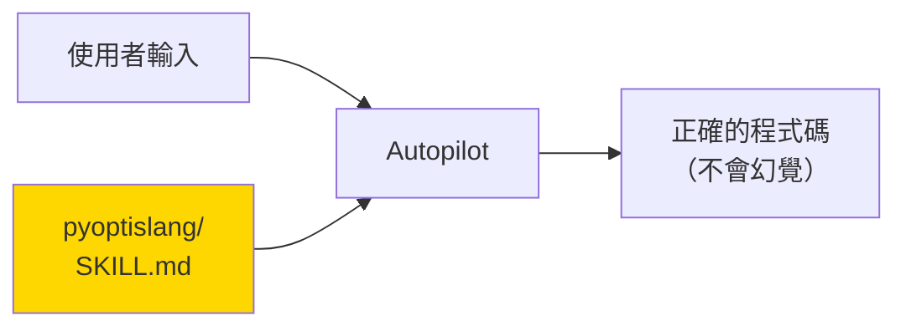
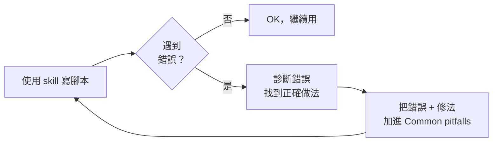

# 03 — Autopilot Skill 設計與訓練方法論 ★ 課程核心 ★

> **本課目標**：學會寫 skill，讓 Autopilot 從「亂猜 API」變成「每次都寫對」。
> **預計閱讀時間**：30 分鐘
> **先備知識**：教材 01、02。你已經寫過一次 PyOptiSLang 腳本，知道有哪些坑。

---

## 3.1 為什麼需要 skill？

### AI 的「訓練資料盲區」

大型語言模型（Claude、GPT 等）的訓練資料來自公開網路。但：

- PyOptiSLang 的使用者相對少，網路教學很稀缺
- Ansys 的 Python API **版本更新很快**，網路上的範例常常是舊版
- 很多細節（例如 `AMopSettings` 的 key 名稱）**從來沒出現在訓練資料裡**

結果：直接問 AI「幫我寫 PyOptiSLang AMOP」會得到看起來合理、但其實 **import 錯誤的 module**、**叫不存在的方法**、**用錯 property key**。這就是「幻覺」。

### 實際案例：這 session 的真實教訓

當我們做 `bandpass_filter_amop.py` 時，Agent 一開始寫了這段：

```python
# ❌ Agent 猜錯了
algo_settings = amop_system.get_property("AlgorithmSettings")
algo_settings["num_discretization"] = 50
amop_system.set_property("AlgorithmSettings", algo_settings)
```

執行後：
```
TypeError: 'NoneType' object does not support item assignment
```

**原因**：AMOP 的 property 叫 `AMopSettings`，不是 `AlgorithmSettings`；key 叫 `num_discretization_initial`，不是 `num_discretization`。
AI 之所以猜錯，是因為訓練資料裡其他演算法（例如 Sensitivity）確實有 `AlgorithmSettings` + `num_discretization`，它「用類比的方式」猜錯了。

### Skill 的功能

**Skill 是一份 markdown 檔**，裡面明確寫出：
- 這個領域的正確 API
- 常見的錯誤寫法
- 必備的生命週期
- 命名慣例、識別碼規則

Autopilot 在對話開始前**載入** skill，skill 的內容就會注入到 Agent 的「思考脈絡」裡。Agent 就不會再亂猜。



---

## 3.2 SKILL.md 的解剖學

一個 skill 就是一個資料夾，資料夾裡至少要有一個 `SKILL.md`：

```
.synopsys_autopilot/skills/pyoptislang/
└── SKILL.md
```

### `SKILL.md` 的結構

```markdown
---
name: pyoptislang
description: Author PyOptiSLang scripts... Use when the user asks to...
---

# PyOptiSLang Scripting

## Instructions
<你的 skill 內容>

## Examples
<具體範例>
```

### YAML frontmatter 兩個必填欄位

| 欄位 | 規則 | 範例 |
|---|---|---|
| `name` | lowercase、hyphen-separated、不能底線結尾 | `pyoptislang`、`find-macro-hotspots` |
| `description` | 1024 字以內、**同時包含 WHAT + WHEN** | 見下 |

### `description` 寫法：WHAT + WHEN

這是整份 skill 最重要的欄位。Autopilot 根據 description 決定「這次對話要不要載入這個 skill」。

**反面示範**（含糊、缺 WHEN）：
```yaml
description: Helps with optiSLang
```

**正面示範**（具體、有 WHEN）：
```yaml
description: >
  Author PyOptiSLang Python scripts that drive Ansys optiSLang workflows:
  start/connect to a server, open/save projects, build parametric systems and nodes,
  register parameters/responses/criteria, run workflows.
  Use when the user asks to script optiSLang, create optimization/sensitivity/
  robustness workflows (AMOP, OCO, NLPQLP, Sensitivity, Robustness),
  run Python scripts inside optiSLang, use ProxySolver with an external callback,
  or build design studies — i.e. anything importing from `ansys.optislang.core`.
```

**關鍵字清單**：寫 description 時把這個領域的 trigger 詞全部塞進去 —— `AMOP`、`OCO`、`optislang`、`parameter`、`metamodel`、`sensitivity`、具體的 module 名…。這樣只要使用者對話出現這些詞，skill 就會自動被 Autopilot 載入。

---

## 3.3 一份好 skill 的四個關鍵區塊

從本課的 `pyoptislang` skill 歸納出四大必備區塊：

### 區塊 1：Imports cheat sheet

直接列出所有常用的 import，讓 Agent 不用猜 module 路徑：

````markdown
### Imports cheat sheet

```python
# Always:
from ansys.optislang.core import Optislang

# Workflow creation:
import ansys.optislang.core.node_types as node_types
from ansys.optislang.core.nodes import (
    DesignFlow, IntegrationNode, ParametricSystem, ProxySolverNode,
)

# Parametric model:
from ansys.optislang.core.project_parametric import (
    OptimizationParameter, ObjectiveCriterion, ComparisonType,
)
```
````

**為什麼重要**：PyOptiSLang 的 class 分散在 5 個以上的 submodule，Agent 常常把 `OptimizationParameter` 寫成 `from ansys.optislang.core import OptimizationParameter`（錯誤）。有這段 cheat sheet 就不會亂寫。

### 區塊 2：Mandatory lifecycle

明文列出「每支腳本都必須做的事」。這段的語氣要**強制**：

````markdown
### Mandatory lifecycle

Every script MUST:

1. Create or connect to an `Optislang` instance (use `ini_timeout=60` for CI).
2. Access `osl.application` / `osl.application.project` for project ops.
3. Call `osl.dispose()` at the end to stop and release the server.

Minimum template:

```python
from ansys.optislang.core import Optislang

osl = Optislang(ini_timeout=60)
try:
    project = osl.application.project
    # ... work ...
finally:
    osl.dispose()
```
````

**為什麼重要**：這是最常被忘記的事。寫在這裡強制 Agent 每次都遵守。

### 區塊 3：Patterns + templates

把工作流程拆成「幾種固定模式」，每種給一個可直接貼用的模板：

````markdown
### Pattern templates

#### 5a. Run Python script inside optiSLang
<code>

#### 5b. Workflow creation (nodes + slots + criteria)
<code>

#### 5c. Evaluate design
<code>

#### 5d. Basic API queries
<code>

#### 5e. ProxySolver + external callback
<code>

#### 5f. Design study from an existing project
<code>

#### 5g. Raw server commands
<code>
````

**為什麼重要**：如果有人問「幫我做一個 OCO」，Agent 直接去找 pattern 5b 或對應範例，不用自己拼湊。

### 區塊 4：Common pitfalls（★★★ 最重要 ★★★）

把你**實際踩過的雷**明確寫出來。這一區每用一次 skill 就會成長一次。

````markdown
### Common pitfalls

- Forgetting `osl.dispose()` leaks the headless optiSLang server.
- Calling `start()` without `save_as()` first produces results you cannot
  inspect later.
- Mutating a `Design` and re-evaluating without `copy_unevaluated_design()`
  always copy before mutating when sweeping.
- Setting parameter bounds via `register_location_as_parameter` alone — the
  parameter is created but with default properties. Always call
  `parent_system.parameter_manager.modify_parameter(OptimizationParameter(...))`
  afterward to set type/range/distribution.
- Running fast tests without `AutoSaveMode="no_auto_save"` — optiSLang will
  spam saves and slow runs.
- Mixing the design-study-manager convenience layer with hand-built
  `root_system.create_node(...)` calls on the same study — choose one layer.
- Using `osl.project.*` passthroughs — prefer `osl.application.project.*`.
````

**為什麼最重要**：這是 skill 「從一般建議」變成「專家級指導」的關鍵。每次 Agent 犯錯，就把那個錯誤加進來。

---

## 3.4 Skill 訓練的「原材料」從哪來？

寫 skill 不是從零空想。優質的素材來源：

### 來源 1：官方 examples

`pyoptislang-main/examples/` 下面有 6 大類範例：

```
examples/
├── api/                              # 基本 API 查詢
├── evaluate_design/                  # 單點評估模式
├── osl_server/                       # 底層 TCP 通訊
├── parametric_design_study_manager/  # 便利高階 API
├── run_python_script/                # 執行內嵌 Python
└── workflow_creation/                # 從零建立工作流程
```

每類至少看一個 example，把共通的模式歸納成 pattern。

### 來源 2：AGENTS.md

PyOptiSLang 原廠寫了一份 `AGENTS.md` 給 AI 看（在 `pyoptislang-main/AGENTS.md`）。它清楚說明：
- 公共 API 的範圍
- 核心階層與類別定義
- 使用慣例與反模式

**強烈建議讀過一次**，很多 skill 內容可以直接精簡自這份文件。

### 來源 3：你自己踩過的雷 ★★

這才是 skill 真正的靈魂。本課第 5 份教材整理了這 session 踩的 4 個 AEDT 雷，全部回填到 skill：

| 踩雷 | 修正 | 寫進 skill 的位置 |
|---|---|---|
| 以為 property key 是 `FilePath` | 實際是 `Path` | AEDT 專章 pitfalls |
| 用 `AlgorithmSettings` 設 sample 數 | AMOP 用 `AMopSettings.num_discretization_initial` | AMOP 專章 pitfalls |
| response 直接用 `dB(St(T1,T1)) []` | 需要合法 identifier 例如 `dB_S11` | identifier 命名 pitfalls |
| 第一次沒加 AEDT 報表 | `get_available_output_locations()` 回傳 0 | AEDT discovery pattern |

---

## 3.5 實作示範：`/create-skill` 指令

Autopilot 內建一個 `/create-skill` slash command，會自動帶著你完成整個 skill 建立流程。

### Session 重現

我們這個 session 的第一個指令就是：

```
/create-skill read pyoptislang-main\examples and create pyoptislang-skill under this working directory
```

Autopilot 做了什麼：

1. **讀取並消化範例** — 依序讀取 `pyoptislang-main/examples/` 下 6 個資料夾、十幾個 .py 檔，以及 `AGENTS.md`。

2. **詢問關鍵參數** — 用 question tool 問：
   - Skill 名稱要用什麼？（推薦 `pyoptislang`，不是 `pyoptislang-skill`，因為慣例不要加 `-skill` 後綴）
   - 存哪裡？（專案層或全域）

3. **呼叫 `create_skill` 工具** — 自動產生：
   - `.synopsys_autopilot/skills/pyoptislang/` 資料夾
   - `SKILL.md` 檔案（含 YAML frontmatter）
   - 自動註冊到 skill registry，立刻可用

### 產出的 skill 總覽

檔案位置：`d:\demo\1012c\.synopsys_autopilot\skills\pyoptislang\SKILL.md`

**內容結構**：

```markdown
---
name: pyoptislang
description: Author PyOptiSLang scripts... Use when ... AMOP, OCO, NLPQLP, Sensitivity, Robustness ...
---

# PyOptiSLang Scripting

## Instructions

### 1. Core concepts         ← 階層圖、名詞解釋
### 2. Mandatory lifecycle   ← try/finally + dispose 模板
### 3. The five canonical workflow patterns  ← 選模式對照表
### 4. Imports cheat sheet
### 5. Pattern templates     ← 5a~5g 七種可貼用的模板
### 6. Node types and design flow
### 7. Common pitfalls       ← ★ 持續成長
### 8. Project save / dispose checklist

## Examples
### Example 1: Ten-bar truss...
### Example 2: Introspect existing project...
### Example 3: Evaluate designs...
### Example 4: NLPQLP + ProxySolver via ParametricDesignStudyManager
### Example 5: Reuse an existing RDO project
### Example 6: Raw TCP command for property edit
```

### 用了 skill 之後的差別

**沒載入 skill 時**：使用者說「幫我做一個 AMOP」—— Agent 可能寫錯 import、忘記 dispose、忘記 modify_parameter。

**載入 skill 後**：Agent 直接去找 pattern 5b，看一下 "Common pitfalls" 區塊，寫出來的程式碼第一次就會跑。

---

## 3.6 Skill 的迭代升級：遇到新錯誤怎麼辦？

Skill 不是寫完就封存。它是**活的文件**，每次踩雷就補充一次。

### 升級流程



### 範例：加入 AEDT 坑

這 session 做到教材 05 的 AEDT 整合時，發現了四個新坑。更新 `pyoptislang/SKILL.md` 的 `Common pitfalls` 區塊：

````markdown
### Common pitfalls

- Forgetting `osl.dispose()` ... (既有)
- ... (既有)

- **(AEDT) Property key is `Path`, not `FilePath`.**
  Unlike `Parameterize` or `ETKAsciiOutput`, AEDT2 node uses:
  ```python
  aedt_node.set_property("Path", {
      "path": {
          "base_path_mode": {"value": "ABSOLUTE_PATH"},
          "split_path": {"head": "", "tail": str(aedt_file)},
      }
  })
  ```

- **(AMOP) Sample count property is `AMopSettings`, not `AlgorithmSettings`.**
  To set 50 initial samples with no refinement:
  ```python
  amop_settings = amop_system.get_property("AMopSettings")
  amop_settings["num_discretization_initial"] = 50
  amop_settings["num_discretization_adaption"] = 0
  amop_settings["max_iteration"] = 1
  amop_settings["num_designs_max"] = 50
  amop_system.set_property("AMopSettings", amop_settings)
  ```

- **(Identifiers) Response names must be valid identifiers.**
  Raw AEDT location names like `"dB(St(T1,T1)) []"` are rejected by
  `register_location_as_response(name=...)`. Pass a sanitised name:
  ```python
  aedt_node.register_location_as_response(
      location=loc["location"],  # keep original AEDT location
      name="dB_S11",             # but use identifier-safe name
  )
  ```

- **(AEDT) `get_available_output_locations()` returns empty if the .aedt file
  has no reports defined.** Open the project in Electronics Desktop and add a
  Modal Solution Data Report before calling `aedt_node.load()`.
````

**下次任何人用 skill 做 AEDT 整合，這四個坑都會自動被避開。**

### 誰負責更新？

- **你**：發現錯誤後，自己改 `SKILL.md`。
- **Autopilot**：你可以直接說「把這個錯誤加進 pyoptislang skill 的 Common pitfalls」，Agent 會自動編輯檔案。

後者更快。

---

## 📝 小練習

這些練習**只要跟 Autopilot 對話**，不要自己手打。

1. **觀察練習**：請 Autopilot：「`列出目前載入了哪些 skill`」。確認 `pyoptislang` 在清單裡。

2. **讀 skill**：請 Autopilot：「`幫我看 pyoptislang skill 的 Common pitfalls 區塊，列出目前有幾條`」。觀察它怎麼讀 skill 檔。

3. **建新 skill**：用 `/create-skill`，建一個 `pyaedt-basics` 骨架 skill（內容隨便，練手感）。觀察 question tool 問你哪些問題。

   > 這個 skill 下一份教材不會用到；純粹練 `/create-skill` 流程。
   > 完成後可以刪掉。

4. **加 pitfall**：請 Autopilot：「`幫我把以下這條加進 pyoptislang skill 的 Common pitfalls：執行 Optislang() 前要先確認沒有其他 optiSLang 進程占著 port`」。觀察它怎麼編輯檔案（Edit tool）。

---

## 📌 本課重點整理

- AI 不懂的領域要用 **skill** 補足，不然會幻覺出不存在的 API。
- Skill = `.synopsys_autopilot/skills/<name>/SKILL.md`，YAML frontmatter 的 `description` 要同時寫 **WHAT + WHEN**。
- 一份好 skill 的四大區塊：**Imports cheat sheet / Mandatory lifecycle / Pattern templates / Common pitfalls**。
- Skill 的素材：**官方 examples + AGENTS.md + 自己踩過的雷**。
- `/create-skill` 一句話幫你建骨架，`create_skill` 工具自動產檔案 + 註冊。
- Skill 是**活的文件**，每次踩雷就補充 Common pitfalls；累積越多，Agent 越專業。

---

## 🔗 相關資源

- 本課 skill 範例：`.synopsys_autopilot/skills/pyoptislang/SKILL.md`
- Autopilot `/create-skill` 命令定義：`.claude/commands/create-skill.md`（或 Autopilot 內建版本）
- PyOptiSLang `AGENTS.md`：`pyoptislang-main/AGENTS.md`
- 第 5 份教材會把這 session 的 AEDT 踩雷實錄回填到 skill，示範「真實 pitfall 升級」

---

## ❓ 自我檢核題

1. 為什麼直接問 AI 「幫我寫 PyOptiSLang AMOP」常常會失敗？
2. SKILL.md 的 `description` 為什麼要同時寫 WHAT + WHEN？
3. 一份好 skill 的四大必備區塊是什麼？
4. 「Common pitfalls」為什麼是四個區塊裡最重要的？
5. Skill 內容過時了怎麼辦？誰負責更新？怎麼讓 Autopilot 幫你更新？

---

## ➡️ 下一份教材預告

**04 — 用 Skill 建立 AMOP / OCO + Python Solver 工作流程**

你會學到：
- 載入 `pyoptislang` skill 後，Autopilot 的「思考過程」如何改變
- 兩個對照範例：**AMOP + Python solver**（教材 02 重做一次，但這次完全讓 skill 寫）vs **OCO + Rosenbrock**
- AMOP vs. OCO vs. Sensitivity：什麼時候用哪個？
- `ParametricDesignStudyManager` 便利層簡介
- 常見錯誤 debug 示範（看 skill 怎麼幫你避開）
