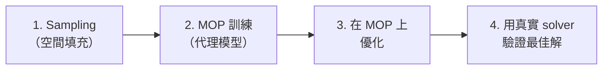
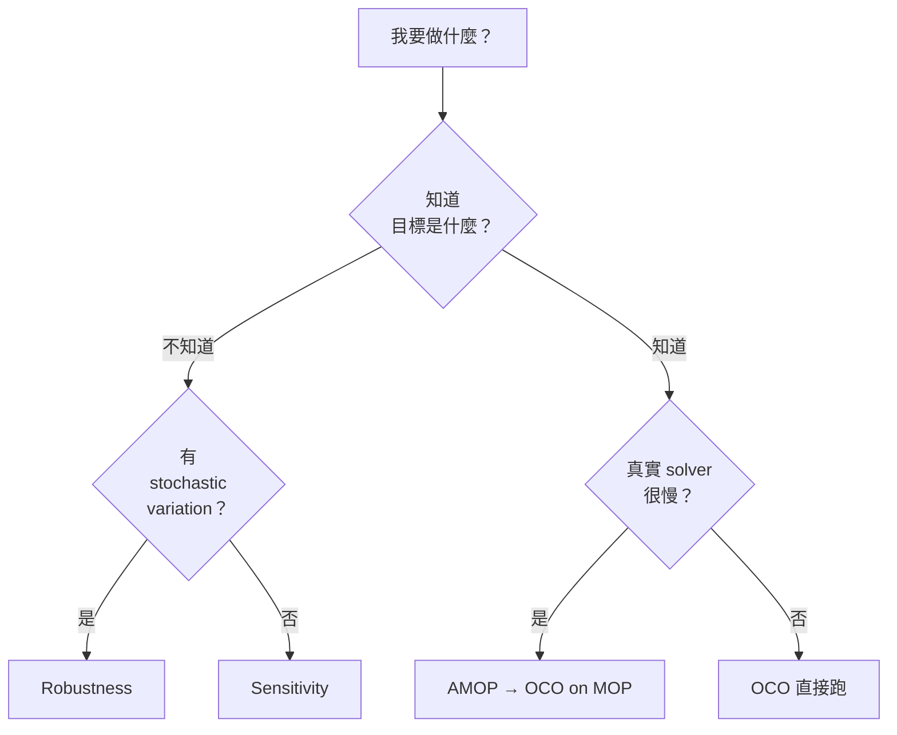

# 04 — 用 Skill 建立 AMOP / OCO + Python Solver 工作流程

> **本課目標**：體驗「我只下自然語言指令，skill 替我寫程式」的工作流程。
> **預計閱讀時間**：25 分鐘
> **先備知識**：教材 01、02、03。`pyoptislang` skill 已載入。

---

## 4.1 載入 skill 後，Agent 的「思考過程」如何改變？

教材 02 你是**自己照程式碼貼一次**。這份教材你會**完全不打字**，只用自然語言跟 Autopilot 說話。

### 為什麼差異這麼大？

**沒載入 skill 時**，Agent 的對話脈絡大概是：
- 「使用者說要 AMOP」
- 「PyOptiSLang 的 AMOP 怎麼寫？我記得有 import `AMOP` from `ansys.optislang`...」（開始猜）
- 「參數要用 `register_parameter` 嗎？還是 `add_parameter`？」（繼續猜）
- 寫出來看起來合理，但其實四處是錯。

**載入 skill 後**，Agent 看到的是：
```
<系統脈絡>
已載入 pyoptislang skill：
  - Imports cheat sheet：
    from ansys.optislang.core import Optislang
    import ansys.optislang.core.node_types as node_types
    from ansys.optislang.core.nodes import DesignFlow, IntegrationNode, ParametricSystem
    from ansys.optislang.core.project_parametric import OptimizationParameter, ...

  - Mandatory lifecycle：
    try/finally + osl.dispose()

  - Pattern 5b (workflow creation)：
    create_node → set_property → register_location_as_parameter →
    modify_parameter → add_criterion → start

  - Common pitfalls：
    - register_location_as_parameter 之後要 modify_parameter 升級為 OptimizationParameter
    - ...
</系統脈絡>

使用者說：「幫我做一個 2 input 1 output 的 AMOP」
```

Agent 直接去抄 pattern 5b 的模板，把 pitfalls 看一遍，第一次就寫對。

---

## 4.2 範例 1：AMOP + Python Solver（這次完全讓 skill 寫）

### Session 重現

這 session 的真實對話：

**使用者**：
> `create a 2 input 1 output python function node in optislang and run amop training`

**Autopilot 的動作**（有載入 pyoptislang skill）：

1. ✅ 選擇 pattern 5b（workflow creation + Python2 solver）
2. ✅ 匯入正確的 module（node_types、nodes、project_parametric）
3. ✅ 用 `try/finally` 包起來、記得 `osl.dispose()`
4. ✅ 兩步驟配置參數（`register_location_as_parameter` → `modify_parameter`）
5. ✅ 設 `AutoSaveMode="no_auto_save"` 加速（這是 skill 寫在 pitfalls 的訣竅）
6. ✅ 寫檔案 + 執行 + 列印結果

產出的程式碼（教材 02 已經解析過）：

```python
"""Create an AMOP sensitivity system driven by a Python2 solver node with
2 input parameters (X1, X2) and 1 response (Y), then run AMOP training.
"""

from pathlib import Path

from ansys.optislang.core import Optislang
import ansys.optislang.core.node_types as node_types
from ansys.optislang.core.nodes import DesignFlow, IntegrationNode, ParametricSystem
from ansys.optislang.core.project_parametric import OptimizationParameter

project_path = Path.cwd() / "amop_python_2in_1out.opf"

osl = Optislang(ini_timeout=60)
try:
    application = osl.application
    application.save_as(project_path)
    project = application.project
    root_system = project.root_system

    # AMOP system
    amop_system: ParametricSystem = root_system.create_node(
        type_=node_types.AMOP, name="AMOP"
    )
    amop_system.set_property("AutoSaveMode", "no_auto_save")
    amop_system.set_property("SolveTwice", True)
    amop_system.set_property("UpdateResultFile", "at_end")

    # Python2 solver
    solver: IntegrationNode = amop_system.create_node(
        type_=node_types.Python2,
        name="Python",
        design_flow=DesignFlow.RECEIVE_SEND,
    )
    solver.set_property("Source",
        "from math import sin\n"
        "Y = 2.0 * X1 + 3.0 * X2 + sin(X1 * X2)\n"
    )

    # Register + modify
    solver.register_location_as_parameter(location="X1", name="X1", reference_value=0.0)
    solver.register_location_as_parameter(location="X2", name="X2", reference_value=0.0)
    solver.register_location_as_response(location="Y", name="Y", reference_value=0.0)

    amop_system.parameter_manager.modify_parameter(
        OptimizationParameter(name="X1", reference_value=0.0, range=(-3.14, 3.14))
    )
    amop_system.parameter_manager.modify_parameter(
        OptimizationParameter(name="X2", reference_value=0.0, range=(-3.14, 3.14))
    )

    # Train AMOP
    project.start()
    application.save()

finally:
    osl.dispose()
```

### 使用者視角：你做了什麼？

```
💬 你輸入一句話（9 個英文單字）
🤖 Autopilot 寫檔、執行、顯示結果
📤 專案成功建立並訓練完
```

就這樣。你不用記 import、不用記 pattern、不用記 pitfall。

---

## 4.3 範例 2：OCO（One Click Optimization）+ Rosenbrock

### 什麼是 OCO？

OCO 是 optiSLang 的「一鍵優化」演算法。它自動結合三件事：



對於**不知道該選什麼演算法**的使用者，OCO 是最省心的選擇。

### Session 重現

**使用者**：
> `create an One click optimization with python node .opf`

**Autopilot 的 question tool 行為**（這是 skill 以外、Autopilot 本身的特性）：

```
❓ OCO workflow style?
   [A] Single OCO + Python solver (Recommended)
   [B] AMOP + OCO on MOP (two-system)

❓ Function to optimize?
   [A] Y = 2*X1 + 3*X2 + sin(X1*X2)
   [B] Rosenbrock: Y = (1-X1)² + 100*(X2-X1²)² (minimum at (1,1))
```

使用者選擇 Single OCO + Rosenbrock。

### 產出的程式碼

```python
"""One-Click Optimization (OCO) workflow driven by a Python2 solver node.

Objective: minimize the classic 2D Rosenbrock function
    Y = (1 - X1)^2 + 100 * (X2 - X1^2)^2
    global minimum at (X1, X2) = (1, 1), Y = 0

Workflow produced
-----------------

    RootSystem
      +-- OCO (ParametricSystem, algorithm = OCO = One Click Optimization)
            +-- Python (IntegrationNode, type = Python2, DesignFlow.RECEIVE_SEND)
                  parameters:  X1, X2
                  response:    Y
                  criterion:   obj = min(Y)
"""

from pathlib import Path

from ansys.optislang.core import Optislang
import ansys.optislang.core.node_types as node_types
from ansys.optislang.core.nodes import DesignFlow, IntegrationNode, ParametricSystem
from ansys.optislang.core.project_parametric import (
    ComparisonType,
    ObjectiveCriterion,
    OptimizationParameter,
)

project_path = Path.cwd() / "one_click_optimization_python.opf"

osl = Optislang(ini_timeout=60)
try:
    application = osl.application
    application.save_as(project_path)
    project = application.project
    root_system = project.root_system

    # 1. OCO parametric system
    oco_system: ParametricSystem = root_system.create_node(
        type_=node_types.OCO, name="OCO"
    )
    oco_system.set_property("AutoSaveMode", "no_auto_save")
    oco_system.set_property("SolveTwice", True)
    oco_system.set_property("UpdateResultFile", "at_end")

    # 2. Python2 solver inside OCO
    solver: IntegrationNode = oco_system.create_node(
        type_=node_types.Python2,
        name="Python",
        design_flow=DesignFlow.RECEIVE_SEND,
    )
    # 2 inputs -> 1 output: Rosenbrock function
    solver.set_property("Source",
        "# Rosenbrock function, minimum at (1, 1)\n"
        "Y = (1.0 - X1) ** 2 + 100.0 * (X2 - X1 ** 2) ** 2\n"
    )

    # 3. Register parameters + response
    solver.register_location_as_parameter(location="X1", name="X1", reference_value=0.0)
    solver.register_location_as_parameter(location="X2", name="X2", reference_value=0.0)
    solver.register_location_as_response(location="Y", name="Y", reference_value=0.0)

    # 4. Refine parameter bounds on the OCO parameter manager
    oco_system.parameter_manager.modify_parameter(
        OptimizationParameter(name="X1", reference_value=0.0, range=(-2.0, 2.0))
    )
    oco_system.parameter_manager.modify_parameter(
        OptimizationParameter(name="X2", reference_value=0.0, range=(-2.0, 2.0))
    )

    # 5. ★★ 新東西：加入最小化目標
    oco_system.criteria_manager.add_criterion(
        ObjectiveCriterion(
            name="obj",
            expression="Y",
            criterion=ComparisonType.MIN,
        )
    )

    # 6. Run One Click Optimization
    project.start()
    application.save()

finally:
    osl.dispose()
```

執行指令：
```bash
uv run python one_click_optimization_python.py
```

### 這個範例多了什麼？

比起 AMOP 範例，多了**第 5 步：加入 ObjectiveCriterion**。

```python
oco_system.criteria_manager.add_criterion(
    ObjectiveCriterion(
        name="obj",             # 目標名稱
        expression="Y",         # 要被評估的 response
        criterion=ComparisonType.MIN,   # 要最小化（也可以 MAX）
    )
)
```

**為什麼 OCO 需要 criterion 而 AMOP 不需要？**

- **AMOP**：只是**訓練 metamodel**，沒有「要優化什麼」的概念。
- **OCO**：要**優化**，所以必須告訴它「什麼叫好」—— 這就是 criterion 的功能。

---

## 4.4 AMOP vs. OCO vs. Sensitivity：什麼時候用哪個？

這是初學者最常問的問題。對照表：

| 系統 | 目的 | 需要 criterion？ | 典型樣本數 | 什麼時候用 |
|---|---|---|---|---|
| **Sensitivity** | 看哪個參數重要 | ❌ 不用 | 50–200 | 設計初期，不知道該調什麼 |
| **AMOP** | 訓練 metamodel | ❌ 不用 | 100–300 | 真實 solver 慢，想用 metamodel 加速後續分析 |
| **OCO** | 找最佳解 | ✅ 要 | 100–500 | 已知目標，想一鍵找最佳 |
| **NLPQLP** | 梯度優化 | ✅ 要 | 20–100 | 連續可微、單目標、local optimum |
| **Robustness** | 評估公差效應 | 通常要 | 500–2000 | 製程公差影響大、要算 yield |

### 決策樹



### 進階模式：AMOP → OCO on MOP

當真實 solver 很慢，典型組合是：

1. 先用 **AMOP** 訓練 metamodel（50–100 次真實模擬）
2. 建一個 **OCO** 系統，裡面放 `Mopsolver`（讀取 AMOP 的 MOP），**不是**真實 solver
3. OCO 在 metamodel 上面跑數千次優化，幾秒鐘搞定
4. 最後驗證階段用真實 solver 跑最佳的 10 個設計

這個 pattern 在官方 example `pyoptislang-main/examples/parametric_design_study_manager/02_optimization_on_mop.py`。
需要時直接請 Autopilot 載入 skill 幫你產生：

```
使用者：幫我做 AMOP 加 OCO on MOP 的組合，sampling solver 用 Python2
Agent：（參考 skill pattern + example 2）→ 產生正確程式碼
```

---

## 4.5 `ParametricDesignStudyManager` 便利層

PyOptiSLang 有一個**高階抽象層**叫 `ansys.optislang.parametric`，比直接操作 `root_system.create_node(...)` 更快。

### 核心類別

```python
from ansys.optislang.parametric.design_study import ParametricDesignStudyManager
from ansys.optislang.parametric.design_study_templates import (
    GeneralAlgorithmTemplate, ProxySolverNodeSettings,
)
```

### 簡化範例

剛才的 NLPQLP + Rosenbrock 用這一層寫會變成：

```python
from math import sin
from pathlib import Path

import ansys.optislang.core.node_types as nt
from ansys.optislang.core.project_parametric import (
    Design, DesignVariable, ObjectiveCriterion,
    OptimizationParameter, Response,
)
from ansys.optislang.parametric.design_study import ParametricDesignStudyManager
from ansys.optislang.parametric.design_study_templates import (
    GeneralAlgorithmTemplate, ProxySolverNodeSettings,
)

# 1. 定義參數、response、criterion
parameters = [
    OptimizationParameter(name=f"X{i}", reference_value=0.0, range=(-3.14, 3.14))
    for i in range(1, 6)
]
responses = [Response(name="Y", reference_value=0.0)]
criteria = [ObjectiveCriterion("minY", expression="Y")]

# 2. 定義 solver 回呼
def callback(designs: list[Design]) -> list[Design]:
    out = []
    for d in designs:
        X = [d.parameters[d.parameters_names.index(f"X{i}")].value for i in range(1, 6)]
        Y = 0.5*X[0] + X[1] + 0.5*X[0]*X[1] + 5*sin(X[2]) + 0.2*X[3] + 0.1*X[4]
        out.append(Design(responses=[DesignVariable("Y", Y)], design_id=d.id))
    return out

# 3. 組 template
template = GeneralAlgorithmTemplate(
    parameters=parameters,
    criteria=criteria,
    responses=responses,
    algorithm_type=nt.NLPQLP,
    solver_type=nt.ProxySolver,
    solver_settings=ProxySolverNodeSettings(callback=callback, multi_design_launch_num=-1),
)

# 4. 跑
mgr = ParametricDesignStudyManager(project_path=Path.cwd() / "study.opf")
try:
    study = mgr.create_design_study(template=template)
    study.execute()
    mgr.save()
finally:
    mgr.optislang.dispose()
```

**優點**：
- 不用自己處理 slot 連線
- Solver 用純 Python callback，不用寫在 `set_property("Source", ...)` 字串裡
- 更適合「我已經知道要做哪種演算法」的情境

**缺點**：
- 彈性較低（只支援 template 提供的組合）
- 不適合複雜的多系統工作流程

**什麼時候用哪個？**
- 單一演算法、單一 solver → 用 `ParametricDesignStudyManager`
- 多系統、多階段工作流程 → 用 `root_system.create_node(...)` 直接建

---

## 4.6 常見錯誤 debug 示範

當 skill 不夠完整時 Agent 還是會犯錯。看看幾個典型場景與修法：

### 場景 1：忘記 modify_parameter

**使用者**：「做一個 Sensitivity + Python solver，X1 範圍 0 到 10」

**Agent 第一次寫出來**（錯誤版）：
```python
solver.register_location_as_parameter(
    location="X1", name="X1", reference_value=5.0, range=(0, 10)  # ❌ 參數 range 不是這樣傳
)
```

執行後：
```
TypeError: register_location_as_parameter() got an unexpected keyword argument 'range'
```

**正確做法**（skill pitfalls 區塊有寫）：
```python
# Step 1: register with default
solver.register_location_as_parameter(location="X1", name="X1", reference_value=5.0)

# Step 2: upgrade to OptimizationParameter with range
sensitivity_system.parameter_manager.modify_parameter(
    OptimizationParameter(name="X1", reference_value=5.0, range=(0.0, 10.0))
)
```

**修補 skill**：如果 Agent 又犯了這個錯，請你的 Autopilot：
> 「這個錯誤已經在 pyoptislang skill 的 pitfalls 區塊了，請確認 skill 有被載入」

### 場景 2：忘記 `osl.dispose()`

**症狀**：執行到一半，電腦變慢，記憶體滿。工作管理員會看到 `optislang.exe` 一直沒關。

**修法**：所有 PyOptiSLang 腳本都要用 `try/finally` 包：
```python
osl = Optislang(ini_timeout=60)
try:
    ...
finally:
    osl.dispose()  # 必做
```

### 場景 3：Criterion name 含特殊字元

**使用者**：「加一個 criterion 叫做 min(stress)」

**Agent 寫出**：
```python
criterion=ObjectiveCriterion(name="min(stress)", expression="stress", criterion=ComparisonType.MIN)
```

執行：
```
OslCommandError: "min(stress)" is not a valid identifier.
```

**修法**：name 只能用 `[A-Za-z0-9_]`：
```python
name="min_stress"  # ✅
```

這個坑在教材 05 的 AEDT response 命名會再碰到一次。

---

## 📝 小練習

全部用 Autopilot 完成，不要自己打程式碼。

1. **AMOP 擴充**：請 Autopilot：「幫我把 `amop_python_2in_1out.py` 改成 3 input / 2 output：`Y1 = X1*X2*X3`、`Y2 = X1+X2+X3`。」

2. **OCO 加約束**：請 Autopilot：「幫我把 `one_click_optimization_python.py` 加一個約束：`X1 + X2 < 1.5`。」

   提示給 Agent（如果它卡住）：用 `ConstraintCriterion` + `ComparisonType.LESSEQUAL` + `limit_expression`。

3. **換 algorithm**：請 Autopilot：「把 OCO 範例改成 NLPQLP。」觀察 Agent 怎麼挑對新的 node type。

4. **用高階層**：請 Autopilot：「用 `ParametricDesignStudyManager` 重寫 `one_click_optimization_python.py`。」比較兩種寫法的差異。

5. **觀察 debug 流程**：故意跟 Autopilot 說：「幫我做一個 Sensitivity，X1 範圍 0 到 10，直接在 register_location_as_parameter 傳 range 參數」。看 Agent 會不會抵抗，還是直接照辦（抵抗 = skill 有效）。

---

## 📌 本課重點整理

- 載入 skill 後，Agent 的「初始脈絡」會多出 pattern + pitfalls，寫出的程式碼第一次就對。
- **AMOP 不需要 criterion，OCO 需要**。因為 AMOP 只訓練 metamodel，OCO 要優化。
- Criterion 三種：`ObjectiveCriterion`、`ConstraintCriterion`、`VariableCriterion`。
- **AMOP / OCO / Sensitivity / NLPQLP / Robustness 的使用情境對照表**要熟。
- `ParametricDesignStudyManager` 是便利層，適合單演算法；複雜 workflow 用低階 `root_system.create_node`。
- 常見錯誤三類：**忘記 modify_parameter / 忘記 dispose / identifier 命名**。這些都該在 skill 的 pitfalls。

---

## 🔗 相關資源

- 本課範例：`d:\demo\1012c\amop_python_2in_1out.py`、`one_click_optimization_python.py`
- `ParametricDesignStudyManager` 官方 example：`pyoptislang-main/examples/parametric_design_study_manager/01_general_algorithm.py`
- AMOP → OCO on MOP 範例：`pyoptislang-main/examples/parametric_design_study_manager/02_optimization_on_mop.py`
- PyOptiSLang 文件：[Node types](https://optislang.docs.pyansys.com/version/stable/api/_autosummary/ansys.optislang.core.node_types.html)

---

## ❓ 自我檢核題

1. 為什麼 OCO 需要 criterion 而 AMOP 不用？
2. `ObjectiveCriterion` 跟 `ConstraintCriterion` 的差別？各寫一個範例。
3. Sensitivity 跟 AMOP 在用途上的核心差別是什麼？
4. 真實 solver 很慢的情況下，為什麼要用「AMOP → OCO on MOP」而不是直接用 OCO？
5. `ParametricDesignStudyManager` 什麼時候比 `root_system.create_node` 好？什麼時候比它差？

---

## ➡️ 下一份教材預告

**05 — 壓軸：AEDT 整合與 Bandpass Filter**

你會學到：
- **Two-stage discovery pattern**：怎麼對付沒有文件的 Python-based integration plugin
- 這 session 真實踩的 4 個 AEDT 雷，與對應的 skill 修補
- 怎麼用自然語言指令完成「12 參數 × 2 S-parameter signal」的 AMOP metamodel 訓練
- 完整的 Bandpass Filter 案例，含真實 HFSS 執行時間與結果解讀
