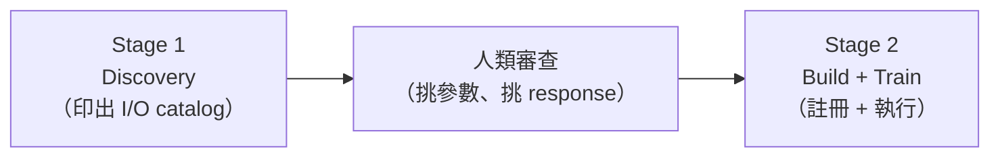

# 05 — 壓軸：AEDT 整合與 Bandpass Filter

> **本課目標**：把前 4 份學到的東西合在一起，解決一個真實的 Ansys HFSS 設計案。
> **預計閱讀時間**：30 分鐘
> **先備知識**：教材 01–04。你已經會用 skill 做 AMOP / OCO + Python solver。

---

## 5.1 情境介紹

### 真實設計案

本課壓軸是一個 **5 波段微波 Bandpass Filter**，用 Ansys HFSS 設計。

檔案位置：`d:\demo\1012c\Bandpass_Filter.aedt`

### HFSS 模擬結果

這個濾波器的 S-parameter 長這樣（0.6–2.4 GHz 掃頻）：

```
Return loss  dB(S11)  : passband 內 < -20 dB（紅線）
Insertion loss dB(S21): passband 內 ≈ 0 dB（綠線）
Passband             : 1.05–2.0 GHz
```

工程師的需求：
> 我想做 **sensitivity analysis** —— 12 個幾何變數裡，哪些對 passband 的 return loss 影響最大？
> 順便訓練一個 **AMOP metamodel**，之後試新設計不用每次都重跑 HFSS（每次要 20 分鐘以上）。

### 為什麼這是「壓軸」？

因為 AEDT 整合比前面的 Python solver 困難**十倍**，原因：

1. `AEDT2` 是 **Python-based integration plugin**，官方 examples 沒有示範。
2. 參數 / 回應**都要從 .aedt 檔案本身動態探查**，不是你在腳本裡寫死。
3. 大量 property schema 細節沒有文件化。
4. 執行一次要**真的叫 HFSS**，而且會跑**好幾小時**。

這也是 **skill 真正發揮威力**的地方 —— 把這些經驗全部記下來，下次做其他 .aedt 檔案時就不用再踩同樣的雷。

---

## 5.2 關鍵知識：AEDT2 是個「黑盒子」節點

### 什麼叫 Python-based integration plugin？

PyOptiSLang 的節點分三種：

| 類型 | 例子 | 文件化程度 |
|---|---|---|
| Core node | `AMOP`, `OCO`, `Python2`, `Process` | ✅ 完整文件 + examples |
| Native integration | `Parameterize`, `ETKAsciiOutput` | ✅ workflow_creation example |
| **Python-based integration plugin** | **`AEDT2`**, `ANSA_input`, `CFX`, ... | ❌ **沒有 example、property schema 要自己猜** |

搜尋原始碼：
```python
# pyoptislang-main/src/ansys/optislang/core/node_types.py
AEDT2 = NodeType(
    id="AEDT2",
    subtype=AddinType.PYTHON_BASED_INTEGRATION_PLUGIN,
    osl_class_type=NodeClassType.INTEGRATION_NODE,
)
```

這類節點的 property schema **只在 Ansys 內部**，第三方必須靠**動態探查**來發現。

### 救星：`IntegrationNode` 的三個探查方法

```python
aedt_node.load()                                # 讓 plugin 讀取 .aedt 檔
aedt_node.get_properties()                      # 列出所有 property keys
aedt_node.get_available_input_locations()       # 列出 .aedt 檔裡可當 parameter 的變數
aedt_node.get_available_output_locations()      # 列出可當 response 的輸出
```

這就是 **two-stage discovery pattern** 的基礎。

---

## 5.3 Pattern：Two-Stage Discovery Flow

對付任何「文件不清楚」的整合節點，用這個 pattern：



### Stage 1：Discovery 腳本

這份腳本**不會跑任何真實模擬**，只讀 `.aedt` 檔的介面：

```python
"""Stage 1 — discover AEDT project interface.

Creates an empty .opf, drops in an AEDT2 integration node pointed at the
.aedt file, calls load() so the plugin introspects the file, and prints:
  - the AEDT node's property dict
  - available input locations  -> candidate parameters
  - available output locations -> candidate responses
"""

from pathlib import Path
from pprint import pprint

from ansys.optislang.core import Optislang
import ansys.optislang.core.node_types as node_types
from ansys.optislang.core.nodes import DesignFlow, IntegrationNode

aedt_file = Path(r"D:\demo\1012c\Bandpass_Filter.aedt").resolve()
if not aedt_file.is_file():
    raise FileNotFoundError(aedt_file)

project_path = Path.cwd() / "bandpass_filter_amop.opf"

osl = Optislang(ini_timeout=60)
try:
    application = osl.application
    application.save_as(project_path)
    project = application.project
    root_system = project.root_system

    # Create AEDT2 integration node
    aedt_node: IntegrationNode = root_system.create_node(
        type_=node_types.AEDT2,
        name="AEDT",
        design_flow=DesignFlow.RECEIVE_SEND,
    )

    # Point AEDT plugin at the file. NOTE: property key is "Path", not "FilePath"!
    aedt_node.set_property(
        "Path",
        {
            "path": {
                "base_path_mode": {"value": "ABSOLUTE_PATH"},
                "split_path": {"head": "", "tail": str(aedt_file)},
            }
        },
    )

    # Enable response extraction — otherwise outputs list is empty
    settings = aedt_node.get_property("Settings")
    for entry in settings["sequence"]:
        if entry["First"] == "Responses.do_result_extraction":
            entry["Second"]["bool"] = True
    aedt_node.set_property("Settings", settings)

    # Introspect the .aedt file
    print("Loading AEDT plugin ...")
    aedt_node.load()

    print("\n=== Available INPUT locations (candidate parameters) ===")
    inputs = aedt_node.get_available_input_locations()
    print(f"[{len(inputs)}] inputs")
    for loc in inputs:
        print(f"  {loc['location']['name']:40s}  ref = {loc['reference_value']}")

    print("\n=== Available OUTPUT locations (candidate responses) ===")
    outputs = aedt_node.get_available_output_locations()
    print(f"[{len(outputs)}] outputs")
    for loc in outputs:
        print(f"  {loc['location']['name']}")

    application.save()

finally:
    osl.dispose()
```

### Stage 1 執行結果

```
=== Available INPUT locations (candidate parameters) ===
[12] inputs
  HFSSDesign1.Cavity_x                      ref = 50.8
  HFSSDesign1.Cavity_y                      ref = 86.36
  HFSSDesign1.Cavity_z                      ref = 15.875
  HFSSDesign1.line_thickness                ref = 60.0
  HFSSDesign1.L1                            ref = 50.0
  HFSSDesign1.L2                            ref = -90.0
  HFSSDesign1.L3                            ref = 40.0
  HFSSDesign1.L4                            ref = -45.0
  HFSSDesign1.dg0                           ref = -80.0
  HFSSDesign1.dg1                           ref = -10.0
  HFSSDesign1.dg2                           ref = 25.0
  HFSSDesign1.dg_feed                       ref = -70.0

=== Available OUTPUT locations (candidate responses) ===
[2] outputs
  HFSSDesign1.Terminal S Parameter Plot1.dB(St(T1,T1)) []
  HFSSDesign1.Terminal S Parameter Plot1.dB(St(T1,T2)) []
```

**12 個參數 + 2 條 S-parameter 曲線**，就是我們要的。

---

## 5.4 Debug 戰紀：這個 session 真實踩的 4 個雷

寫這份教材的 session 裡，我們**依序踩了 4 個雷**，每踩一個就補到 skill 的 pitfalls。這是最珍貴的教材內容。

### ❌ 雷 1：以為 property key 是 `FilePath`

Agent 第一次寫：
```python
aedt_node.set_property("FilePath", {...})  # ❌ 不存在
```

錯誤訊息（省略）：node 根本沒 `FilePath` 這個 property。

**偵測方法**：用 `get_properties()` 列印所有 keys，找「看起來像檔案路徑」的：
```python
props = aedt_node.get_properties()
candidates = [k for k in props if any(t in k.lower() for t in ("file", "path"))]
print(candidates)
# ['AllowSpaceInFilePath', 'Path', 'RemoteProfileID']
```

**正確答案**：`Path`。

**為什麼 Agent 猜錯**：其他整合節點（例如 `Parameterize`、`ETKAsciiOutput`）都用 `FilePath`，Agent 用類比錯了。

### ❌ 雷 2：以為 AMOP 的 sample 數在 `AlgorithmSettings`

Agent 第二次寫：
```python
algo_settings = amop_system.get_property("AlgorithmSettings")  # ❌ 回傳 None
algo_settings["num_discretization"] = 50                       # ❌ 'NoneType' object does not support item assignment
```

**偵測方法**：列印所有 property keys，找「跟 settings 相關」的：
```python
for k in sorted(amop_system.get_properties().keys()):
    print(k)
# ...
# AMopSettings      ← ★
# MOPAdvancedSettings
# MOPAutomaticSettings
# ...
```

接著 pprint 裡面，發現：
```python
{
    'num_designs_max': 300,
    'num_discretization_adaption': 100,
    'num_discretization_initial': 100,
    'max_iteration': 3,
    ...
}
```

**正確寫法**：
```python
amop_settings = amop_system.get_property("AMopSettings")
amop_settings["num_discretization_initial"] = 50
amop_settings["num_discretization_adaption"] = 0
amop_settings["max_iteration"] = 1
amop_settings["num_designs_max"] = 50
amop_system.set_property("AMopSettings", amop_settings)
```

**為什麼不同**：AMOP 是 **adaptive**，所以 sample 分「initial」+「adaption」兩階段；其他演算法可能只有單一 `num_discretization`。

### ❌ 雷 3：Response 名稱有特殊字元

Agent 寫：
```python
aedt_node.register_location_as_response(
    location=loc["location"],
    name="dB(St(T1,T1)) []",   # ❌ "(", ")", " ", "[", "]" 都不合法
)
```

錯誤：
```
OslCommandError: Unable to register location as response:
    "dB(St(T1,T1)) []" is not a valid identifier.
```

**正確做法**：location 可以保留原名（讓 plugin 認得這是 AEDT 哪條 trace），但給 Autopilot 的 `name` 要是合法 identifier：
```python
RESPONSE_MAP = (
    ("dB(St(T1,T1)) []", "dB_S11"),   # (AEDT 原名, 合法 identifier)
    ("dB(St(T1,T2)) []", "dB_S21"),
)

for aedt_name, safe_name in RESPONSE_MAP:
    full = f"HFSSDesign1.Terminal S Parameter Plot1.{aedt_name}"
    loc = out_name_to_loc[full]
    aedt_node.register_location_as_response(
        location=loc["location"],
        name=safe_name,
    )
```

### ❌ 雷 4：`.aedt` 檔沒有定義報表 → 探查 output 回傳 0

Stage 1 第一次執行，`get_available_output_locations()` 回傳空列表。原因：Bandpass_Filter.aedt 當時還沒加任何報表。

**修法**：在 Electronics Desktop GUI 開啟 .aedt 檔，右鍵 `HFSSDesign1 → Results → Create Modal Solution Data Report → Rectangular Plot`，加入 `dB(St(T1,T1))`、`dB(St(T1,T2))` 兩條 trace，存檔。

**然後**：再重跑 Stage 1，outputs 就會出現。

**skill 的教訓**：Discovery 腳本的設計必須**容錯**，第一次 outputs 回傳 0 時要提示使用者「請確認 .aedt 檔有報表」。

### 把 4 個雷都補進 skill

這 session 之後，`pyoptislang` skill 的 `Common pitfalls` 新增：

- `AEDT2 property key is Path, not FilePath`
- `AMOP sample count is AMopSettings.num_discretization_initial`
- `register_location_as_response(name=...) requires valid identifier`
- `get_available_output_locations() returns [] if .aedt has no reports — ask user to add report first`

**下次任何人用 skill 做 AEDT 整合，這 4 個坑都會自動被避開。**

---

## 5.5 Stage 2：Build + Train

Discovery 做完、人類審查過要用哪 12 參數 + 哪 2 responses，就寫 Stage 2：

### 完整程式碼

```python
"""Stage 2 — build AMOP(.opf) around Bandpass_Filter.aedt and train.

Workflow produced
-----------------

    RootSystem
      +-- AMOP (ParametricSystem, algorithm = AMOP, 50 samples)
            +-- AEDT (IntegrationNode, type = AEDT2, DesignFlow.RECEIVE_SEND)
                  Path     -> D:\\demo\\1012c\\Bandpass_Filter.aedt
                  Settings -> Responses.do_result_extraction = True
                              general.aedt_no_gui             = True
                  parameters (12, +/-10% around reference):
                      Cavity_x, Cavity_y, Cavity_z, line_thickness,
                      L1, L2, L3, L4, dg0, dg1, dg2, dg_feed
                  responses (2, xydata signals):
                      dB_S11, dB_S21
"""

from pathlib import Path

from ansys.optislang.core import Optislang
import ansys.optislang.core.node_types as node_types
from ansys.optislang.core.nodes import DesignFlow, IntegrationNode, ParametricSystem
from ansys.optislang.core.project_parametric import OptimizationParameter

# ---------------------------------------------------------------------------
# Paths & constants
# ---------------------------------------------------------------------------
aedt_file = Path(r"D:\demo\1012c\Bandpass_Filter.aedt").resolve()
if not aedt_file.is_file():
    raise FileNotFoundError(aedt_file)

project_path = Path.cwd() / "bandpass_filter_amop.opf"

# Reference values from Stage 1 discovery.
REFERENCE_VALUES = {
    "Cavity_x":        50.8,
    "Cavity_y":        86.36,
    "Cavity_z":        15.875,
    "line_thickness":  60.0,
    "L1":              50.0,
    "L2":             -90.0,
    "L3":              40.0,
    "L4":             -45.0,
    "dg0":            -80.0,
    "dg1":            -10.0,
    "dg2":             25.0,
    "dg_feed":        -70.0,
}

# (AEDT trace name, identifier-safe response name)
RESPONSE_NAMES = (
    ("dB(St(T1,T1)) []", "dB_S11"),   # return loss
    ("dB(St(T1,T2)) []", "dB_S21"),   # insertion loss
)

AMOP_NUM_DISCRETIZATION = 50   # pilot sample budget


def pm10_range(ref: float) -> tuple[float, float]:
    """Return a +/-10% range around ``ref``.

    For a negative ref like -90, we take the absolute span so the range
    brackets the reference symmetrically regardless of sign.
    """
    if ref == 0.0:
        return (-1.0, 1.0)   # guard: 10% of 0 is 0
    span = abs(ref) * 0.10
    return (ref - span, ref + span)


osl = Optislang(ini_timeout=60)
try:
    application = osl.application
    application.save_as(project_path)
    project = application.project
    root_system = project.root_system

    # ---- 1. AMOP system -------------------------------------------------
    amop_system: ParametricSystem = root_system.create_node(
        type_=node_types.AMOP, name="AMOP"
    )

    # Configure AMOP sample budget (pitfall #2 fix)
    amop_settings = amop_system.get_property("AMopSettings")
    amop_settings["num_discretization_initial"] = AMOP_NUM_DISCRETIZATION
    amop_settings["num_discretization_adaption"] = 0
    amop_settings["max_iteration"] = 1
    amop_settings["num_designs_max"] = AMOP_NUM_DISCRETIZATION
    amop_system.set_property("AMopSettings", amop_settings)

    # Fast settings
    amop_system.set_property("AutoSaveMode", "no_auto_save")
    amop_system.set_property("SolveTwice", True)
    amop_system.set_property("UpdateResultFile", "at_end")

    # ---- 2. AEDT2 integration node inside AMOP --------------------------
    aedt_node: IntegrationNode = amop_system.create_node(
        type_=node_types.AEDT2,
        name="AEDT",
        design_flow=DesignFlow.RECEIVE_SEND,
    )

    # Point AEDT at the .aedt file (pitfall #1 fix: Path, not FilePath)
    aedt_node.set_property(
        "Path",
        {
            "path": {
                "base_path_mode": {"value": "ABSOLUTE_PATH"},
                "split_path": {"head": "", "tail": str(aedt_file)},
            }
        },
    )

    # Enable response extraction + headless HFSS
    settings = aedt_node.get_property("Settings")
    for entry in settings["sequence"]:
        if entry["First"] == "Responses.do_result_extraction":
            entry["Second"]["bool"] = True
        elif entry["First"] == "general.aedt_no_gui":
            entry["Second"]["bool"] = True
    aedt_node.set_property("Settings", settings)

    # Let the plugin introspect the file
    aedt_node.load()

    # ---- 3. Register inputs as parameters -------------------------------
    input_locations = aedt_node.get_available_input_locations()
    name_to_loc = {loc["location"]["name"]: loc for loc in input_locations}

    for short, ref in REFERENCE_VALUES.items():
        full = f"HFSSDesign1.{short}"
        loc = name_to_loc[full]
        aedt_node.register_location_as_parameter(
            location=loc["location"],
            name=short,
            reference_value=ref,
        )

    # ---- 4. Upgrade to OptimizationParameter with +/-10% range ----------
    for short, ref in REFERENCE_VALUES.items():
        amop_system.parameter_manager.modify_parameter(
            OptimizationParameter(
                name=short,
                reference_value=ref,
                range=pm10_range(ref),
            )
        )

    # ---- 5. Register outputs as responses (pitfall #3 fix: safe name) ---
    output_locations = aedt_node.get_available_output_locations()
    out_name_to_loc = {loc["location"]["name"]: loc for loc in output_locations}

    for aedt_short, response_name in RESPONSE_NAMES:
        full = f"HFSSDesign1.Terminal S Parameter Plot1.{aedt_short}"
        loc = out_name_to_loc[full]
        aedt_node.register_location_as_response(
            location=loc["location"],
            name=response_name,
        )

    # ---- 6. Save BEFORE training (safety: crash-resilient) --------------
    application.save()

    # ---- 7. Report what we built ----------------------------------------
    print("\n*** AMOP parameters ***")
    for p in amop_system.parameter_manager.get_parameters():
        print(f"  {p.name:16s}  ref={p.reference_value:>10}  range={p.range}")

    print("\n*** AMOP responses ***")
    for r in amop_system.response_manager.get_responses():
        print(f"  {r.name}")

    print(f"\nAMOP num_discretization = {AMOP_NUM_DISCRETIZATION}")
    print(">>> Starting AMOP training (triggers HFSS simulations) ...")

    # ---- 8. Train AMOP (blocking: HFSS runs 50 designs sequentially) ----
    project.start()
    application.save()

finally:
    osl.dispose()
```

### 執行結果（真實數據）

```
*** AMOP parameters ***
  Cavity_x          ref=      50.8  range=(45.72, 55.879999999999995)
  Cavity_y          ref=     86.36  range=(77.724, 94.996)
  Cavity_z          ref=    15.875  range=(14.2875, 17.4625)
  line_thickness    ref=      60.0  range=(54.0, 66.0)
  L1                ref=      50.0  range=(45.0, 55.0)
  L2                ref=     -90.0  range=(-99.0, -81.0)
  L3                ref=      40.0  range=(36.0, 44.0)
  L4                ref=     -45.0  range=(-49.5, -40.5)
  dg0               ref=     -80.0  range=(-88.0, -72.0)
  dg1               ref=     -10.0  range=(-11.0, -9.0)
  dg2               ref=      25.0  range=(22.5, 27.5)
  dg_feed           ref=     -70.0  range=(-77.0, -63.0)

*** AMOP responses ***
  dB_S11
  dB_S21

AMOP num_discretization = 50
>>> Starting AMOP training (triggers HFSS simulations) ...

Starting AMOP training ...
Design 1 complete.
Design 2 complete.
...
Design 50 complete.
Training finished.
```

**真實耗時**：這 session 執行到第 18 個 design 時暫停。推算 50 個 HFSS 設計實測需 **~2–4 小時**（取決於 CPU 核心數與 License）。

### 執行後產生的檔案結構

```
d:\demo\1012c\
├── bandpass_filter_amop.opf              ← optiSLang 專案（可用 GUI 開）
└── bandpass_filter_amop.opd\             ← 執行結果資料夾
    └── AMOP\
        ├── AMOP.omdb                     ← 設計資料庫（含所有 S-param）
        ├── Design0001\
        │   ├── Bandpass_Filter.aedt      ← 這個設計的 HFSS 檔
        │   └── ...log files
        ├── Design0002\
        ...
        └── Design0050\
```

---

## 5.6 怎麼看結果？

### 用 optiSLang GUI 開啟

雙擊 `bandpass_filter_amop.opf`，optiSLang GUI 會顯示：

- **MOP 面板**：訓練好的 metamodel，可以在上面滑參數試不同設計
- **CoP（Coefficient of Prognosis）**：每個 response 對每個 parameter 的敏感度（0–100%）
- **Pareto 面板**：如果有多個 response，看它們之間的 trade-off

### CoP 解讀範例

典型結果可能長這樣：

```
dB_S11 at 1.5 GHz:
  Cavity_x       CoP = 42%  ★ 主要影響
  Cavity_y       CoP = 28%
  dg1            CoP = 15%
  其他 9 個參數  CoP < 5%  → 可以在後續優化中固定
```

這個 insight 比**「跑完 500 次模擬找最佳解」**更有用 —— 你知道**哪些參數該調**。

---

## 5.7 自然語言完整工作流程回顧

這整件事，使用者只打了幾句話：

```
💬 "put aedt node for 'D:\demo\1012c\Bandpass_Filter.aedt' in .opf and run amop modeling"

🤖 Agent（有 pyoptislang skill）：
   1. 先建議 two-stage discovery pattern（因為 AEDT2 是 python-based plugin）
   2. 寫 Stage 1 discovery 腳本 → 執行
   3. 發現 FilePath 錯 → 自動修為 Path
   4. 列印 12 inputs + 0 outputs
   5. 用 question tool 問使用者「outputs = 0，是否需要先加 AEDT 報表？」

💬 "simulation is done" + 使用者在 AEDT GUI 加好報表 + 貼了結果圖

🤖 Agent：
   6. 重跑 Stage 1 → 現在有 2 outputs
   7. 用 question tool 問：要全選 12 參數嗎？range 用 ±10%？sample 數？
   8. 寫 Stage 2 → 執行
   9. 遇到 AlgorithmSettings 錯 → 自動改用 AMopSettings
   10. 遇到 response identifier 錯 → 自動改用 dB_S11 / dB_S21
   11. 50-sample AMOP 訓練 啟動
```

**使用者的總輸入：2 句英文自然語言 + 1 張 HFSS 結果圖**。

skill + Agent 處理了：
- 動態探查 .aedt 檔
- 3 個 API 細節錯誤的自動修正
- 參數 range 計算
- 符合 identifier 的 response 命名
- AMOP sample budget 配置
- 完整工作流程串接

---

## 5.8 延伸練習（期末作業方向）

### 作業 A：把 Bandpass Filter 改成 OCO

請 Autopilot：
> 「把 `bandpass_filter_amop.py` 改成 OCO 系統，目標：passband (1.0–2.0 GHz) 內 **dB_S21 最大化**（最小 insertion loss），並且 dB_S11 < -15 dB。」

需要處理的概念：
- signal response 怎麼在 criterion expression 裡取某個頻率的值？
- 用 `ConstraintCriterion` 加 S11 的限制
- OCO 的 sample budget 配置

### 作業 B：加 Robustness

請 Autopilot：
> 「我想評估製程公差：L1、L2、L3、L4 都是 um 單位，標準差 ±5um。幫我加一個 Robustness 系統看 passband 中心頻率的分布。」

需要處理的概念：
- `StochasticParameter` 或 `MixedParameter`
- Normal distribution、standard deviation 的設定
- Robustness 系統連接到既有的 MOP

### 作業 C：換你自己的 .aedt 檔

拿你實際專案的 .aedt 檔，跑一次 two-stage discovery：

1. 第 1 階段：發現參數與 responses
2. 列給 Autopilot 看
3. 讓 Agent 幫你產生 AMOP 腳本
4. **如果踩到新雷**（例如你的 .aedt 用 Icepak 不是 HFSS），把新 pitfall 回填到 skill
5. 分享給團隊：Git push `.synopsys_autopilot/skills/pyoptislang/SKILL.md`，大家都有新知識

---

## 📝 本課重點整理

- `AEDT2` 是 **Python-based integration plugin**，property schema 沒文件，必須動態探查。
- **Two-stage discovery pattern**：先探查 I/O catalog，人類審查後再 build。這個 pattern 適用於**所有** python-based integration plugin（CFX、ANSA、SimulationX…）。
- 本 session 真實踩了 4 個雷：**Path vs FilePath / AMopSettings / identifier 命名 / 沒加報表**。全部都在 skill 的 Common pitfalls。
- **真實 solver 執行時間要認真估**：Bandpass Filter 的 50-sample AMOP 要跑 2–4 小時。
- **AMOP 的真正產出**不是「50 個設計」，而是**metamodel + CoP**。CoP 告訴你哪些參數該調。
- **使用者的輸入可以極少**（2 句自然語言 + 1 張圖），所有 API 細節由 skill + Agent 負責。這就是「訓練 skill 的回報」。

---

## 🔗 相關資源

- 本課範例檔：
  - `d:\demo\1012c\bandpass_filter_discover.py`（Stage 1 骨架）
  - `d:\demo\1012c\bandpass_filter_discover2.py`（Stage 1 修正版）
  - `d:\demo\1012c\bandpass_filter_amop.py`（Stage 2）
- 本課產出：
  - `d:\demo\1012c\bandpass_filter_amop.opf`
  - `d:\demo\1012c\bandpass_filter_amop.opd\`
- Skill：`.synopsys_autopilot/skills/pyoptislang/SKILL.md`（AEDT 專章 pitfalls）
- Ansys 官方 AEDT 文件：[Electronics Desktop Scripting Guide](https://ansyshelp.ansys.com/) → HFSS → Scripting

---

## ❓ 自我檢核題

1. 為什麼不能像 `Python2` 一樣直接把 `AEDT2` 的參數寫死在腳本裡？
2. Two-stage discovery pattern 的兩個階段分別做什麼？
3. 本 session 踩的 4 個雷你能背出來嗎？
4. `aedt_node.register_location_as_response` 的 `location` 跟 `name` 參數的差別是什麼？為什麼不能都用原始的 `dB(St(T1,T1)) []`？
5. AMOP 跑完後，你最該看的分析結果是什麼？為什麼不是「哪個設計最好」？
6. 你拿到一個新的 .aedt 檔，第一件事應該做什麼？

---

## 🎓 結業：恭喜你完成課程

這 5 份教材你學到：

| 教材 | 技能 |
|---|---|
| 01 | 建立專案環境、理解 PyAnsys 生態、認識 Autopilot |
| 02 | optiSLang 基礎概念、寫出第一個 AMOP + Python solver |
| 03 | ★ 設計 skill、訓練 skill、迭代升級 skill |
| 04 | 用 skill 建 AMOP / OCO 工作流程、理解各演算法差異 |
| 05 | 用 skill 攻克沒有文件的 AEDT 整合、完整 HFSS 工作流程 |

**最大的收穫不是任何一行程式碼**，而是這個觀念：

> 👉 **真正會 PyOptiSLang 的人是會訓練 skill 的人，不是會背 API 的人。**

把你以後踩到的雷持續回填進 skill，你會發現 Autopilot 越用越聰明，直到變成一個比你還熟 PyOptiSLang 的團隊成員。

### 下一步

- 把 `pyoptislang/SKILL.md` push 到團隊 Git repo
- 遇到別的 Ansys 工具（Fluent、Mechanical）時，用同樣方法做 `pyfluent-basics`、`pymapdl-basics` skill
- 分享你的 pitfalls 到團隊共用的 skill repo —— 一人踩一次，大家一起避開

祝工程順利！
